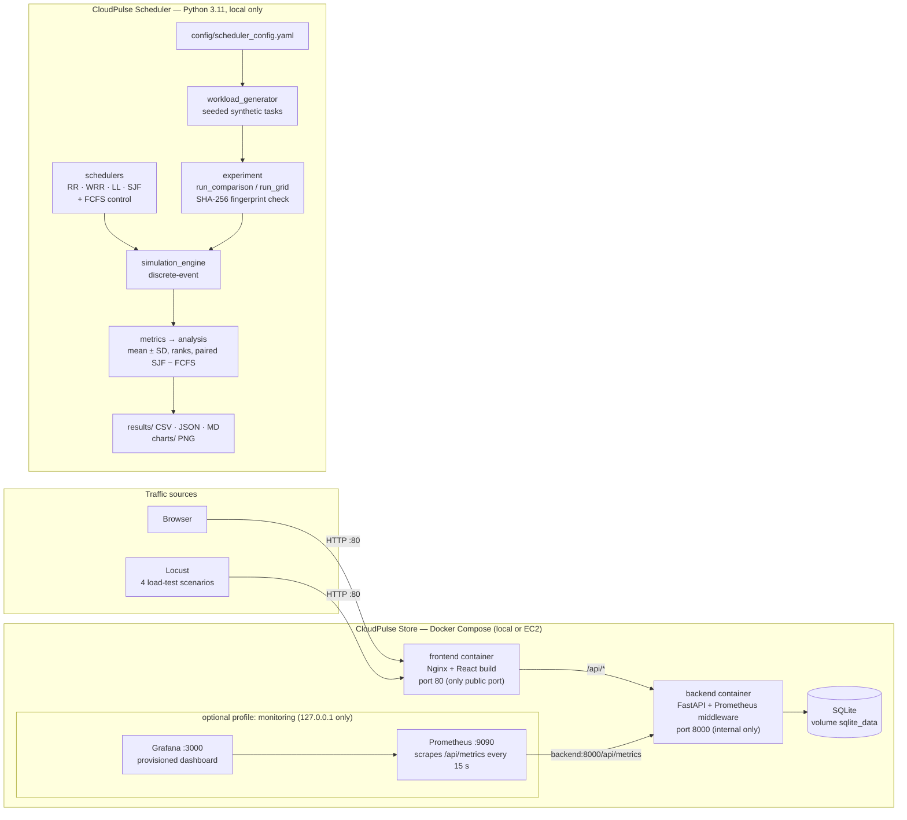
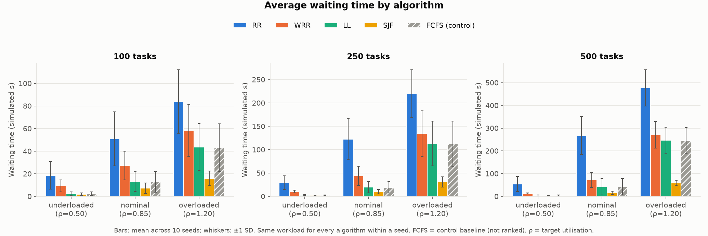
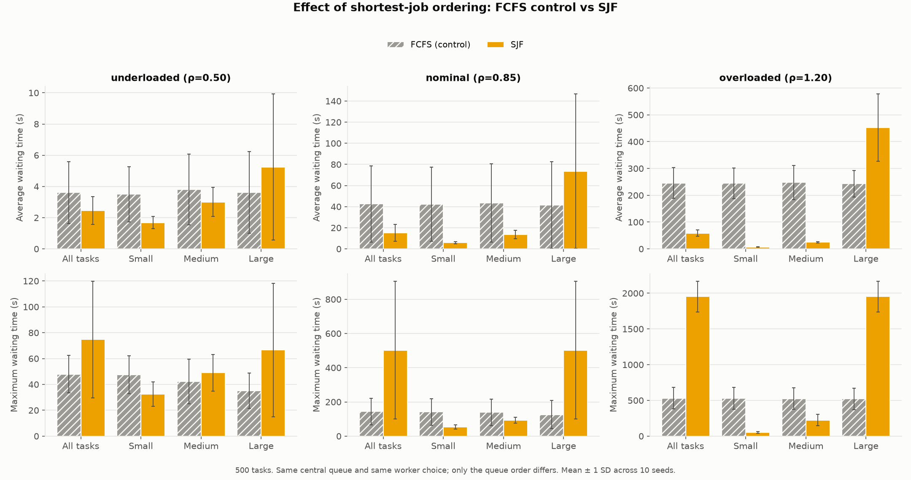

# CloudPulse: Intelligent Cloud Resource Monitoring and Workload Scheduling System

CloudPulse is a university Cloud Computing project (BITS Pilani) about two linked
questions: how to **observe** a cloud-hosted service, and how to **schedule** work across
machines of different speeds. The repository has two independent applications:

| Application | What it is | Status |
|---|---|---|
| [**CloudPulse Store**](cloudpulse-store/README.md) | A demonstration e-commerce site (React + FastAPI + SQLite) in Docker Compose. It produces real web/API traffic and exposes health checks and Prometheus metrics, with an optional Prometheus + Grafana stack and Locust load tests | Complete; 33 backend tests pass; Docker-verified locally; EC2 deployment scripts and guide provided |
| [**CloudPulse Scheduler**](cloudpulse-scheduler/README.md) | A deterministic discrete-event simulator that compares **Round Robin, Weighted Round Robin, Least Loaded and Shortest Job First** on heterogeneous workers, with **FCFS as a control baseline** | Complete through Stage 5 (experiments + documentation); 220 tests pass; runs locally; **not containerised or deployed to EC2** |

> **Important:** the two applications share a project, not code. The scheduler's workers are
> simulated objects; its times are **simulated seconds** and its utilisation is **simulated busy
> time**, not EC2 CPU measurements. The scheduler does not read the store's metrics.

---

## Contents
1. [Problem statement](#1-problem-statement)
2. [Objectives](#2-objectives)
3. [System architecture](#3-system-architecture)
4. [CloudPulse Store](#4-cloudpulse-store)
5. [Monitoring architecture](#5-monitoring-architecture-prometheus--grafana)
6. [CloudPulse Scheduler](#6-cloudpulse-scheduler)
7. [Experimental methodology](#7-experimental-methodology)
8. [Validation (Stage 3) and experiments (Stage 4)](#8-validation-stage-3-and-experiments-stage-4)
9. [Results and findings](#9-results-and-findings)
10. [Installation and local execution](#10-installation-and-local-execution)
11. [AWS deployment](#11-aws-deployment)
12. [Testing](#12-testing)
13. [Project structure](#13-project-structure)
14. [Limitations and future improvements](#14-limitations-and-future-improvements)
15. [Academic scope and acknowledgements](#15-academic-scope-and-acknowledgements)

---

## 1. Problem statement

A cloud service receives a stream of requests or tasks of different sizes and must run them on
machines that are not equally fast. Two things decide whether it performs well:

- **Visibility** — operators need to see availability, request rates, latency, errors and
  resource use, or they cannot tell when queues grow and users wait.
- **Scheduling** — every task must be assigned to a worker and ordered. A poor policy leaves fast
  workers idle while tasks queue behind slow ones; a policy that favours short tasks can make long
  tasks wait much longer.

CloudPulse studies the first with a real, instrumented web application and the second with a
controlled simulation in which every algorithm sees exactly the same workload.

## 2. Objectives

1. Build a containerised web application that generates realistic traffic and exposes health and
   performance metrics in Prometheus format.
2. Provide a Prometheus + Grafana monitoring stack and repeatable Locust load-test scenarios.
3. Provide scripts and a guide to run the application on AWS EC2 Ubuntu without exposing internal
   ports.
4. Implement four scheduling algorithms (RR, WRR, LL, SJF) behind one interface, plus an FCFS
   control baseline.
5. Compare them fairly — identical workloads and workers, fingerprint-checked — over several
   workload sizes, load levels and random seeds, reporting mean ± standard deviation.
6. Validate correctness (exactly-once execution, no overlap, hand-calculated traces, no use of
   hidden information) before drawing conclusions.

## 3. System architecture



There is no connection between the two applications at runtime. A combined dashboard that shows
scheduler results next to store metrics is a possible future step (§14), not implemented.

## 4. CloudPulse Store

A small online shop — browse, search, cart, checkout, contact form — with **no real products and
no payments**. It exists to produce web and API traffic that can be monitored and load-tested.

| Layer | Technology |
|---|---|
| Frontend | React 18, Vite, Tailwind CSS, React Router, Axios; built and served by Nginx |
| Backend | Python 3.11, FastAPI, Pydantic, SQLAlchemy 2, Uvicorn (one worker) |
| Database | SQLite on a Docker named volume; 24 demo products in 6 categories seeded on first start |
| Infrastructure | Docker, Docker Compose, Nginx; AWS EC2 Ubuntu scripts |
| Testing / load | Pytest + HTTPX (33 tests); Locust scenarios `BrowsingUser`, `SearchUser`, `OrderUser`, `MixedWorkloadUser` |

Nginx serves the website and proxies `/api/*` to FastAPI on the internal Docker network, so the
browser makes only same-origin requests and the backend port is never published. Orders run in one
transaction with an atomic stock check (`409` on insufficient stock).

Main endpoints: `/api/health`, `/api/ready`, `/api/products`, `/api/products/search`,
`/api/products/{id}`, `/api/categories`, `/api/orders`, `/api/contact`, `/api/metrics`,
`/api/stats`, plus Swagger UI at `/api/docs`.

Details: [store README](cloudpulse-store/README.md) ·
[architecture](cloudpulse-store/docs/ARCHITECTURE.md) ·
[API reference](cloudpulse-store/docs/API_DOCUMENTATION.md) ·
[load testing](cloudpulse-store/load-testing/README.md)

## 5. Monitoring architecture (Prometheus + Grafana)

| Part | Implementation |
|---|---|
| Instrumentation | `backend/app/core/metrics.py` — pure ASGI middleware recording every request with route-template labels (low cardinality) |
| Metrics | `cloudpulse_http_requests_total`, `cloudpulse_http_request_duration_seconds` (histogram), `cloudpulse_http_errors_total`, `cloudpulse_http_requests_in_progress`, `cloudpulse_app_uptime_seconds`, `cloudpulse_orders_created_total`, `cloudpulse_contact_messages_total`, and `process_*` CPU/memory from `prometheus_client` |
| Collection | Prometheus `v3.1.0` scrapes `backend:8000/api/metrics` every 15 s; 7-day retention |
| Visualisation | Grafana `11.4.0` with a provisioned datasource and the dashboard *CloudPulse Store - Application Overview*: requests/s, error rate, p50/p95/p99 latency, uptime, requests by endpoint, errors by status, in-flight requests and orders/min |
| Exposure | Prometheus and Grafana bind to `127.0.0.1` only; on EC2 they are reached through an SSH tunnel. Grafana credentials come from `.env` |

Start it with `docker compose --profile monitoring up --build -d` in `cloudpulse-store/`.
Configuration: [`cloudpulse-store/monitoring/`](cloudpulse-store/monitoring/README.md).

## 6. CloudPulse Scheduler

A standalone simulator with three heterogeneous workers — W1, W2, W3 with relative speed
**1.0 / 0.6 / 0.4** (50 / 30 / 20 % of capacity). Execution is non-preemptive; a worker with
capacity `c` runs a task in `actual_duration / c` simulated seconds. Schedulers see only an
**estimated** duration (actual × Uniform(0.8, 1.2)); the engine runs the hidden actual duration.

### Four primary algorithms

| Algorithm | Dispatch model | How it decides | Uses task size? |
|---|---|---|---|
| **Round Robin (RR)** | Per-worker FIFO queue, decided on arrival | Strict rotation W1, W2, W3, … | No |
| **Weighted Round Robin (WRR)** | Per-worker FIFO queue, decided on arrival | Smooth (Nginx-style) WRR, weights 5:3:2 | No |
| **Least Loaded (LL)** | Per-worker FIFO queue, decided on arrival | Worker with the lowest estimated remaining work ÷ capacity | Estimates |
| **Shortest Job First (SJF)** | Central queue, decided when a worker is idle | Shortest estimated task first; fastest idle worker first | Estimates |

### FCFS — control baseline

**First-Come-First-Served is not a fifth algorithm** and is never ranked. It uses the same central
queue and the same worker-selection code as SJF but serves tasks in arrival order. This separates
two effects that SJF otherwise mixes:

- **SJF − FCFS** = effect of shortest-first ordering alone;
- **FCFS − RR/WRR/LL** = effect of the central queue and worker choice, without size ordering.

FCFS appears in every table and chart as "FCFS (control)".

Details: [scheduler README](cloudpulse-scheduler/README.md) ·
[design](cloudpulse-scheduler/docs/design.md) ·
[algorithms](cloudpulse-scheduler/src/schedulers/README.md)

## 7. Experimental methodology

| Factor | Values |
|---|---|
| Workers | W1/W2/W3, capacity 1.0/0.6/0.4, WRR weights 5:3:2 (fixed for all runs) |
| Task sizes | small 60 % Uniform(1, 5) s · medium 30 % Uniform(5, 20) s · large 10 % Uniform(20, 60) s; mean 9.55 s |
| Estimates | actual × Uniform(0.8, 1.2) (±20 %) |
| Arrivals | Poisson, rate = ρ × total capacity (2.0) ÷ mean task size |
| Load ρ | underloaded 0.50 · nominal 0.85 · overloaded 1.20 |
| Workload sizes | 100, 250, 500 tasks |
| Seeds | 42–51 (10 seeds) |
| Configurations | RR, WRR, LL, SJF + FCFS control |
| **Total** | 3 × 3 × 10 × 5 = **450 runs** |

**Fairness.** Each (size, load, seed) cell generates one workload, frozen and given to all five
configurations. SHA-256 fingerprints of the workload and the worker configuration are checked in
every run (90 workload fingerprints, one worker fingerprint). Same engine, clock, tie-breaking and
metric code for every configuration.

**Statistics.** For each metric: mean and **sample** standard deviation (n − 1) over the 10 seeds,
win counts per seed, competition ranks on the means (primaries only), and **paired** per-seed
SJF − FCFS differences.

**Metrics.** Average / p95 / maximum waiting time, turnaround, response time, makespan,
throughput, simulated worker utilisation and its imbalance, load distribution per worker,
idle-while-waiting %, and waiting time per task class.

Full detail: [`docs/methodology.md`](cloudpulse-scheduler/docs/methodology.md).

## 8. Validation (Stage 3) and experiments (Stage 4)

The scheduler was built in stages: 1 plan · 2 core · 3 validation · 4 experiments ·
5 documentation · 6 Docker/EC2 (**not started**).

**Stage 3 — fairness and reliability validation** (recorded with 194 tests, before FCFS was
added; the suite now has 220). Verified:

| Check | Result |
|---|---|
| Identical inputs | One workload hash per size and one worker hash across all algorithms |
| Determinism | 10 repeats and 3 processes with different `PYTHONHASHSEED`: one result digest per algorithm |
| Exactly-once execution / no overlap per worker | 0 violations (independent checker `tests/invariants.py`) |
| Metric correctness | 4 full traces calculated by hand match exactly; independent reference metrics differ by 0.00e+00 |
| No use of actual duration | Runtime spy, deliberately cheating scheduler detected, static source scan, counterfactual with scrambled actual durations: 0 violations |
| Edge cases | Unavailable worker, 100-task burst, 150 % overload, queue limits, empty workload: all tasks complete |

Report: [`stage3_validation_report.md`](cloudpulse-scheduler/docs/stage3_validation_report.md).

**Stage 4 — experiment grid.** 450 runs (wall-clock 1.64 s on one Apple M1 core, informational
only). Outputs: [`results/stage4-grid/`](cloudpulse-scheduler/results/stage4-grid/README.md)
(CSV/JSON/Markdown) and 10 charts in
[`charts/stage4-grid/`](cloudpulse-scheduler/charts/stage4-grid/README.md).
Findings: [`stage4_results.md`](cloudpulse-scheduler/docs/stage4_results.md).

## 9. Results and findings

Source: `cloudpulse-scheduler/results/stage4-grid/`. Mean ± sample SD over 10 seeds, in simulated
seconds. These results hold for this model (three heterogeneous workers, unbiased ±20 % estimates,
Poisson arrivals); they are not a general ranking of the algorithms.

### 500 tasks — average waiting time (mean ± SD) / maximum waiting time (mean)

| | Underloaded ρ = 0.50 | Nominal ρ = 0.85 | Overloaded ρ = 1.20 |
|---|---|---|---|
| RR | 54.25 ± 33.67 / 435.04 | 266.74 ± 83.89 / 1389.33 | 477.06 ± 79.86 / 2110.92 |
| WRR | 12.62 ± 2.78 / 166.69 | 72.03 ± 33.15 / 359.71 | 270.93 ± 58.35 / 731.08 |
| LL | 3.69 ± 1.88 / 53.11 | 42.41 ± 35.97 / 150.99 | 246.43 ± 57.01 / 543.97 |
| SJF | 2.46 ± 0.88 / 74.71 | 15.15 ± 7.89 / 502.67 | 58.44 ± 11.67 / 1952.46 |
| FCFS (control) | 3.61 ± 1.98 / 47.92 | 42.55 ± 36.16 / 143.60 | 245.74 ± 56.96 / 531.07 |



### Key findings

1. **No algorithm is best on every metric.** SJF ranks 1st on average waiting, turnaround,
   response and p95 waiting time in all 9 (size × load) cells; **LL ranks 1st on maximum waiting
   time in all 9 cells**.
2. **RR is worst on every time metric in every cell.** It gives each worker a third of the work,
   but W3 has only 20 % of the capacity: at 500 tasks / nominal load W3 is 97.7 % busy while W1
   is 39.8 % busy.
3. **WRR** matches the capacity split (task shares 50.0 / 30.0 / 20.0 %) but cannot react to
   queue build-up: a free worker sits idle while tasks wait elsewhere 7.7–18.1 % of the time
   (RR 22.0–29.9 %, LL 0.2–0.3 %, SJF/FCFS 0 by design). It ranks 3rd on average waiting time.
4. **Shortest-first ordering has a cost.** Compared with FCFS on identical workloads, SJF cuts
   average waiting time by 21–76 % (more as load rises), but large-task average waiting rises
   by 62–86 % at nominal and overloaded load, and maximum waiting time rises up to +267.6 %
   (500 tasks overloaded: 531 → 1952 s). With no ageing, this is starvation.
5. **Ordering, not the central queue, explains SJF's lead over LL.** FCFS and LL differ by less
   than 1 s in average waiting time in every cell (500 nominal: 42.55 vs 42.41 s).
6. **Higher utilisation is not better performance.** Underloaded, RR has the highest mean
   utilisation (57.0 % vs LL 49.4 % at 500 tasks) together with the worst waiting times, because
   it overloads the slow worker.
7. **Makespan differences among LL, SJF and WRR are smaller than the seed-to-seed SD**
   (500 nominal: 2876 ± 120, 2901 ± 118, 2979 ± 127 s), so their makespan ranks are not meaningful.



All cells and tables: [`stage4_results.md`](cloudpulse-scheduler/docs/stage4_results.md) and
[`comparison_tables.md`](cloudpulse-scheduler/results/stage4-grid/comparison_tables.md).

The store's Locust load tests produce their own measurements; no store load-test results are
included in this repository (see [load-testing](cloudpulse-store/load-testing/README.md)).

## 10. Installation and local execution

### Prerequisites

| Tool | Needed for |
|---|---|
| Docker + Docker Compose (Docker Desktop, OrbStack or Colima) | Running CloudPulse Store |
| Python 3.11 ([`uv`](https://docs.astral.sh/uv/) recommended) | Scheduler, store backend tests, Locust |
| Node.js 20.19+ (22 recommended) | Store frontend development and build |

```bash
git clone <repository-url> cloudpulse
cd cloudpulse
```

### CloudPulse Store (Docker)

```bash
cd cloudpulse-store
cp .env.example .env                 # optional; defaults work locally
docker compose up --build -d         # http://localhost  (API docs: http://localhost/api/docs)
docker compose ps                    # wait for "healthy"
docker compose --profile monitoring up --build -d   # + Prometheus :9090 and Grafana :3000
docker compose down                  # stop (add -v to delete the database)
```

On a Mac with Colima run `colima start` first. Development without Docker:
[`cloudpulse-store/docs/LOCAL_SETUP.md`](cloudpulse-store/docs/LOCAL_SETUP.md).

### Load testing (optional)

```bash
cd cloudpulse-store/load-testing
python3.11 -m venv .venv && source .venv/bin/activate && pip install -r requirements.txt
./run_scenarios.sh http://localhost 20 5 1m      # all four scenarios, headless
```

### CloudPulse Scheduler

```bash
cd cloudpulse-scheduler
uv venv --python 3.11 .venv && uv pip install --python .venv -r requirements.txt
.venv/bin/python -m src.main --algorithm all --tasks 100     # one workload, RR/WRR/LL/SJF + FCFS
.venv/bin/python -m src.main --grid --experiment-id my-grid  # full 450-run grid
```

Without `uv`: `python3.11 -m venv .venv && .venv/bin/pip install -r requirements.txt`.
Outputs go to `results/<experiment-id>/` and `charts/<experiment-id>/`.
`--experiment-id stage4-grid` would overwrite the reported results.

## 11. AWS deployment

The store includes scripts for an **AWS EC2 Ubuntu** instance
([`cloudpulse-store/deployment/aws/`](cloudpulse-store/deployment/aws/README.md)). They never create
AWS resources or read AWS credentials.

```bash
ssh -i <path-to-your-key>.pem ubuntu@<EC2-public-IP>
git clone <repository-url> cloudpulse && cd cloudpulse/cloudpulse-store
bash deployment/aws/ec2-setup.sh     # installs Docker; log out and back in
bash deployment/aws/deploy.sh        # build, start, wait for /api/ready, print URLs
```

- Security group: SSH 22 from **your IP only**; HTTP 80 (and 443 for HTTPS) public.
  Never open 8000, 9090 or 3000 — Prometheus and Grafana are reached with an SSH tunnel.
- `deploy.sh` creates `.env` from `.env.example` with a random Grafana password if none exists.
- In this monorepo `.git` is at the root, so update with `git -C .. pull --ff-only` before
  re-running `deploy.sh`.
- Keep the SSH key outside the repository. No instance addresses, keys or credentials are
  stored in this repository.
- A running instance, its EBS volume and any Elastic IP are billed; stop or terminate it when
  not in use.

Full guide (HTTPS with Let's Encrypt, updates, shutdown, costs):
[`cloudpulse-store/docs/AWS_DEPLOYMENT.md`](cloudpulse-store/docs/AWS_DEPLOYMENT.md).
The **scheduler is not deployed to EC2**; containerising it is the planned Stage 6.

## 12. Testing

| Suite | Command | Expected |
|---|---|---|
| Scheduler | `cd cloudpulse-scheduler && .venv/bin/python -m pytest` | 220 passed |
| Scheduler Stage 3 evidence | `cd cloudpulse-scheduler && .venv/bin/python -m scripts.validate_stage3` | Prints fingerprints, invariant and determinism checks |
| Store backend | `cd cloudpulse-store/backend && python3.11 -m venv .venv && .venv/bin/pip install -r requirements-dev.txt && .venv/bin/python -m pytest` | 33 passed |
| Store frontend build | `cd cloudpulse-store/frontend && npm ci && npm run build` | Build succeeds, output in `dist/` |
| Store system checks | See [`TESTING_GUIDE.md`](cloudpulse-store/docs/TESTING_GUIDE.md) | Endpoints, browser flow, persistence, metrics |

Test details: [scheduler tests](cloudpulse-scheduler/tests/README.md) ·
[store backend tests](cloudpulse-store/backend/tests/README.md).

## 13. Project structure

Every tracked folder has its own `README.md`.

```
cloudpulse/
├── README.md                     this file
├── LICENSE                       MIT License (whole repository)
├── .gitignore                    root ignore rules for both applications
├── cloudpulse-store/             demonstration e-commerce site
│   ├── README.md
│   ├── compose.yaml              backend, frontend, optional Prometheus + Grafana
│   ├── .env.example              configuration template (no secrets)
│   ├── backend/                  FastAPI app (app/: api, core, database, schemas, services) + tests/
│   ├── frontend/                 React + Vite app (src/, public/products/, scripts/), Nginx config
│   ├── monitoring/               prometheus/ scrape config, grafana/provisioning/
│   ├── load-testing/             Locust scenarios, runner, results summariser
│   ├── deployment/aws/           EC2 setup and deploy scripts, host Nginx (HTTPS) config
│   └── docs/                     architecture, API, local setup, testing, AWS guide
└── cloudpulse-scheduler/         scheduling simulator
    ├── README.md
    ├── config/                   scheduler_config.yaml
    ├── src/                      engine, workload, workers, metrics, analysis, exporters, CLI
    │   └── schedulers/           RR, WRR, LL, SJF, FCFS control
    ├── tests/                    220 pytest tests
    ├── scripts/                  validate_stage3.py
    ├── data/workloads/           saved workloads (empty by default)
    ├── results/stage4-grid/      verified 450-run results
    ├── charts/stage4-grid/       10 result charts
    ├── docs/                     design, methodology, Stage 3 report, Stage 4 results
    └── requirements.txt, pytest.ini, .gitignore
```

## 14. Limitations and future improvements

### Limitations
- **The scheduler is a simulation.** Times are simulated seconds and utilisation is simulated
  busy time; they are not EC2 CPU, memory or latency measurements.
- **Simplified worker model:** constant speeds, static availability, one task at a time, no
  network/dispatch overhead, no failures, no work stealing.
- **Estimate model:** LL and SJF rely on unbiased ±20 % estimates; real estimates may be worse.
- **SJF has no ageing**, so large tasks can starve.
- **Statistical scope:** 10 seeds, one worker configuration and one task-size mix; no formal
  significance tests (paired differences and win counts are used).
- **Store:** demonstration only (no payments, accounts or authentication); SQLite allows one
  writer at a time; one Uvicorn worker per container; HTTPS requires your own domain.
- **Not delivered from the original proposal:** a separate monitoring dashboard application
  (monitoring is provided by Prometheus + Grafana instead), worker-failure experiments,
  single- vs multi-machine comparisons, and running the scheduler on cloud infrastructure.

### Future improvements (not implemented)
- SJF with ageing; work stealing between per-worker queues.
- Sensitivity studies with biased or heavy-tailed estimates and task sizes; more seeds and
  confidence intervals.
- Containerise the scheduler (Stage 6) and export its summary metrics to the existing
  Prometheus/Grafana stack.
- Store: PostgreSQL (e.g. Amazon RDS), several backend workers with Prometheus multiprocess mode,
  load balancing / auto scaling, CI with GitHub Actions.

## 15. Academic scope and acknowledgements

CloudPulse was developed as a two-member team project for the **Cloud Computing** course at
**BITS Pilani** (2026). It is an academic study, not a production system: the store sells nothing
and the scheduler does not run real workloads.

We thank the course instructor for reviewing and approving the project proposal and for the
guidance to study several scheduling strategies.

Open-source software used includes FastAPI, SQLAlchemy, Pydantic, Uvicorn, React, Vite,
Tailwind CSS, Nginx, Docker, Prometheus, Grafana, Locust, pytest, PyYAML and matplotlib.

The whole repository is released under the MIT License ([`LICENSE`](LICENSE)).
