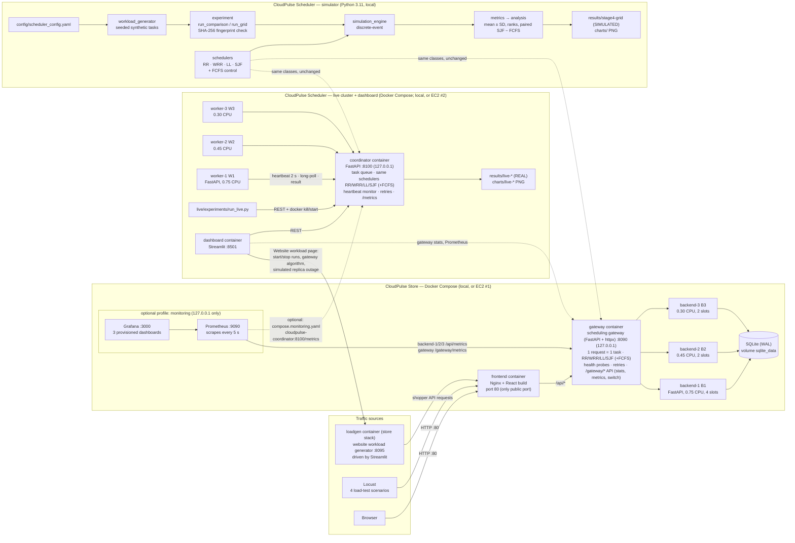
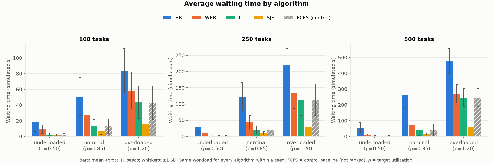
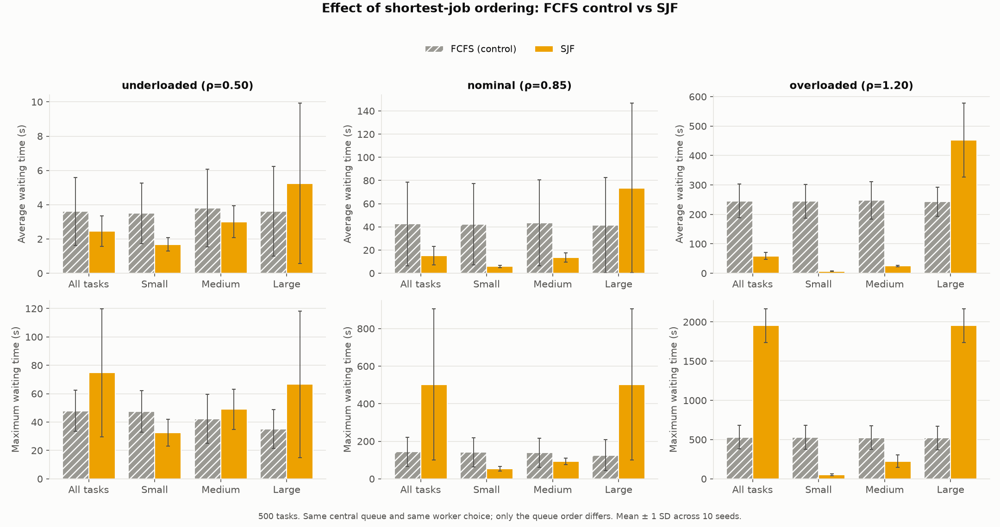
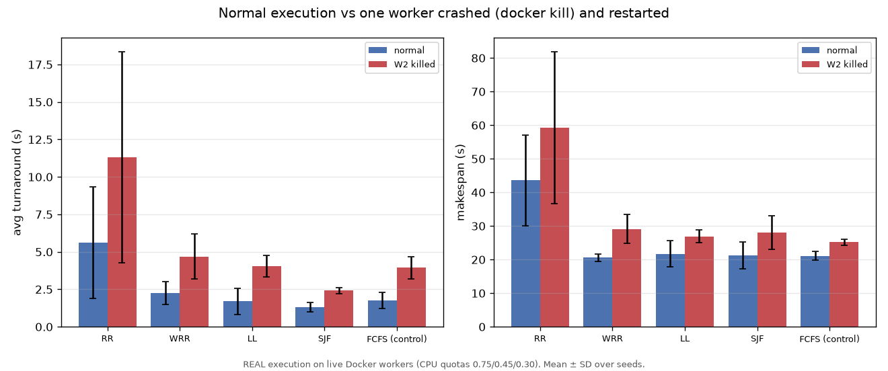

# CloudPulse: Intelligent Cloud Resource Monitoring and Workload Scheduling System

CloudPulse is a university Cloud Computing project (BITS Pilani) about two linked
questions: how to **observe** a cloud-hosted service, and how to **schedule** work across
machines of different speeds. The repository has two independent applications:

| Application | What it is | Status |
|---|---|---|
| [**CloudPulse Store**](cloudpulse-store/README.md) | A demonstration e-commerce site (React + FastAPI + SQLite) in Docker Compose. It produces real web/API traffic and exposes health checks and Prometheus metrics, with an optional Prometheus + Grafana stack and Locust load tests | Complete; 38 backend + 24 gateway + 17 loadgen tests pass; Docker-verified locally; two-EC2 deployment (store instance + dashboard instance, cloned from GitHub, configured only through `.env`) prepared and simulated locally, **not yet deployed** |
| [**CloudPulse Scheduler**](cloudpulse-scheduler/README.md) | **Round Robin, Weighted Round Robin, Least Loaded and Shortest Job First** on heterogeneous workers, with **FCFS as a control baseline**, in two forms: (a) a deterministic discrete-event **simulator** (450-run grid) and (b) a **live cluster** ([`live/`](cloudpulse-scheduler/live/README.md)): FastAPI coordinator + three real FastAPI worker containers with CPU quotas, heartbeats, failure detection and retry, psutil CPU/memory monitoring, a Streamlit dashboard and Prometheus metrics | Simulator complete (220 tests). Live cluster complete and Docker-verified locally (46 tests, 266 total); real-execution experiments recorded in `results/live-mac-20261112/`. Two-EC2 deployment (this stack on its own instance) prepared, **not yet deployed**; multi-machine worker run prepared, **not yet run** |

> **Important:** two kinds of scheduler results exist and are never mixed. The **simulator**
> (`src/`, `results/stage4-grid/`) reports **simulated seconds** and simulated busy time. The
> **live cluster** (`live/`, `results/live-*/`) reports **real wall-clock execution**, real psutil
> CPU/memory and real container crashes, on one Docker host (three worker containers, not three
> machines). The store's Prometheus can scrape the live coordinator (§5); otherwise the two
> applications are independent.

### Highlights

- **Observe:** React + FastAPI store (three backend replicas behind a scheduling gateway) with
  Prometheus metrics, three provisioned Grafana dashboards, four Locust load-test scenarios and a
  dashboard-driven website workload generator, all in Docker Compose.
- **Schedule:** 450 reproducible simulation runs (3 sizes × 3 load levels × 10 seeds × 5
  configurations) with fingerprint-checked fairness, plus a live cluster of real worker containers
  (120 recorded runs, 7 650 tasks, none lost, including worker crashes).
- **Headline result:** no algorithm wins everywhere. SJF has the best average waiting time but
  starves large tasks; Least Loaded has the best worst-case wait; Round Robin is worst because it
  ignores worker speed (see [§9](#9-results-and-findings)). The live cluster confirms the ranking.

### Quick start

```bash
git clone https://github.com/mohana9985/CloudPulse.git cloudpulse && cd cloudpulse

# Store -> http://localhost  (API docs at /api/docs)
cd cloudpulse-store && cp .env.example .env && docker compose up --build -d && cd ..

# Scheduler -> compare all algorithms on one 100-task workload
cd cloudpulse-scheduler
uv venv --python 3.11 .venv && uv pip install --python .venv -r requirements.txt
.venv/bin/python -m src.main --algorithm all --tasks 100
```

Windows (PowerShell) commands: [§10 Windows](#windows-powershell). Full setup, monitoring and
testing instructions are in [§10](#10-installation-and-local-execution); AWS deployment in
[§11](#11-aws-deployment).

---

## Contents
1. [Problem statement](#1-problem-statement)
2. [Objectives](#2-objectives)
3. [System architecture](#3-system-architecture)
4. [CloudPulse Store](#4-cloudpulse-store)
5. [Monitoring architecture](#5-monitoring-architecture-prometheus--grafana)
6. [CloudPulse Scheduler](#6-cloudpulse-scheduler)
7. [Experimental methodology](#7-experimental-methodology)
8. [Validation (Stage 3) and experiments (Stage 4)](#8-validation-stage-3-and-experiments-stage-4)
9. [Results and findings](#9-results-and-findings)
10. [Installation and local execution](#10-installation-and-local-execution) (macOS and [Windows](#windows-powershell))
11. [AWS deployment](#11-aws-deployment)
12. [Testing](#12-testing)
13. [Project structure](#13-project-structure)
14. [Limitations and future improvements](#14-limitations-and-future-improvements)
15. [Academic scope and acknowledgements](#15-academic-scope-and-acknowledgements)

---

## 1. Problem statement

A cloud service receives a stream of requests or tasks of different sizes and must run them on
machines that are not equally fast. Two things decide whether it performs well:

- **Visibility** — operators need to see availability, request rates, latency, errors and
  resource use, or they cannot tell when queues grow and users wait.
- **Scheduling** — every task must be assigned to a worker and ordered. A poor policy leaves fast
  workers idle while tasks queue behind slow ones; a policy that favours short tasks can make long
  tasks wait much longer.

CloudPulse studies the first with a real, instrumented web application and the second with a
controlled simulation in which every algorithm sees exactly the same workload.

## 2. Objectives

1. Build a containerised web application that generates realistic traffic and exposes health and
   performance metrics in Prometheus format.
2. Provide a Prometheus + Grafana monitoring stack and repeatable Locust load-test scenarios.
3. Provide scripts and a guide to run the application on AWS EC2 Ubuntu without exposing internal
   ports.
4. Implement four scheduling algorithms (RR, WRR, LL, SJF) behind one interface, plus an FCFS
   control baseline.
5. Compare them fairly — identical workloads and workers, fingerprint-checked — over several
   workload sizes, load levels and random seeds, reporting mean ± standard deviation.
6. Validate correctness (exactly-once execution, no overlap, hand-calculated traces, no use of
   hidden information) before drawing conclusions.

## 3. System architecture



The live cluster reuses the simulator's scheduler classes unchanged: the coordinator keeps a
mirror `Worker` object per real worker and calls `select_worker()` (RR/WRR/LL) or
`select_idle_worker()`/`pop_next_task()` (SJF/FCFS) exactly as the simulation engine does. With
`compose.monitoring.yaml` the store's Prometheus scrapes the coordinator and Grafana shows the
provisioned **"CloudPulse Scheduler - Live Cluster"** dashboard next to the store dashboard.

**The same algorithms are also applied to the website's own traffic** (added November 2026): the
store backend runs as three replicas with CPU quotas 0.75 / 0.45 / 0.30, and a *scheduling
gateway* between Nginx and the replicas turns every `/api/*` request into a scheduling task,
routing it with RR, WRR, Least Loaded, SJF or the FCFS control. The shop stays a plain website;
the gateway exposes JSON/Prometheus endpoints on <http://localhost:8090/gateway/*> (algorithm
switch, per-replica distribution, queue wait, service time, archived runs).

**The Streamlit dashboard drives the website** (page *Website workload*, default page): it
starts seeded workloads of real shopper requests through the `loadgen` service, which sends
them to Nginx, so they are scheduled by the gateway like browser clicks. The page shows the
work on the website (progress, latency, which replica served each request, per-replica load,
events, run comparison); Grafana shows the metrics. The second page, *Compute cluster*, is the
live scheduler with computational tasks. Details:
[`cloudpulse-store/scheduler-gateway/README.md`](cloudpulse-store/scheduler-gateway/README.md) and
[`cloudpulse-store/docs/SCHEDULING.md`](cloudpulse-store/docs/SCHEDULING.md).

## 4. CloudPulse Store

A small online shop — browse, search, cart, checkout, contact form — with **no real products and
no payments**. It exists to produce web and API traffic that can be monitored and load-tested.

| Layer | Technology |
|---|---|
| Frontend | React 18, Vite, Tailwind CSS, React Router, Axios; built and served by Nginx |
| Backend | Python 3.11, FastAPI, Pydantic, SQLAlchemy 2, Uvicorn; **three replicas** B1/B2/B3 (0.75 / 0.45 / 0.30 CPU) |
| Scheduling gateway | FastAPI + httpx; routes each API request to a replica with RR / WRR / LL / SJF / FCFS (classes from `cloudpulse-scheduler/src/schedulers`, unchanged) |
| Database | SQLite (WAL) on a Docker named volume shared by the replicas; 24 demo products in 6 categories seeded by replica 1 |
| Infrastructure | Docker, Docker Compose, Nginx; AWS EC2 Ubuntu scripts |
| Testing / load | Pytest + HTTPX (38 backend tests); Locust scenarios `BrowsingUser`, `SearchUser`, `OrderUser`, `MixedWorkloadUser` |

Nginx serves the website and proxies `/api/*` to the scheduling gateway, which forwards each
request to one FastAPI replica on the internal Docker network, so the browser makes only
same-origin requests and no backend port is published. Each response carries
`x-cloudpulse-backend` / `x-cloudpulse-wait-ms` / `x-cloudpulse-service-ms` headers;
`GET http://localhost:8090/gateway/stats` shows the live picture. Orders run in one
transaction with an atomic stock check (`409` on insufficient stock).

Main endpoints: `/api/health`, `/api/ready`, `/api/products`, `/api/products/search`,
`/api/products/{id}`, `/api/categories`, `/api/orders`, `/api/contact`, `/api/metrics`,
`/api/stats`, plus Swagger UI at `/api/docs`. Gateway: `/gateway/stats`, `/gateway/recent`,
`/gateway/events`, `/gateway/runs`, `POST /gateway/algorithm`, `POST /gateway/reset`,
`/gateway/metrics`, Swagger UI at `/gateway/docs` (all on port 8090, localhost only — in the
two-EC2 setup reachable only from the dashboard instance).

Details: [store README](cloudpulse-store/README.md) ·
[architecture](cloudpulse-store/docs/ARCHITECTURE.md) ·
[API reference](cloudpulse-store/docs/API_DOCUMENTATION.md) ·
[load testing](cloudpulse-store/load-testing/README.md)

## 5. Monitoring architecture (Prometheus + Grafana)

| Part | Implementation |
|---|---|
| Instrumentation | `backend/app/core/metrics.py` — pure ASGI middleware recording every request with route-template labels (low cardinality) |
| Metrics | `cloudpulse_http_requests_total`, `cloudpulse_http_request_duration_seconds` (histogram), `cloudpulse_http_errors_total`, `cloudpulse_http_requests_in_progress`, `cloudpulse_app_uptime_seconds`, `cloudpulse_orders_created_total`, `cloudpulse_contact_messages_total`, and `process_*` CPU/memory from `prometheus_client` |
| Collection | Prometheus `v3.1.0` scrapes every 5 s: `backend-1/2/3:8000/api/metrics`, `gateway:8090/gateway/metrics`, `loadgen:8095/metrics` and the live coordinator; 7-day retention |
| Visualisation | Grafana `11.4.0` with a provisioned datasource and three dashboards: *CloudPulse Store - Application Overview* (requests/s, error rate, p50/p95/p99 latency, uptime, requests by endpoint, errors by status, in-flight requests and orders/min), *CloudPulse Store - Request Scheduling Gateway* (active algorithm, share/latency/health per replica, plus a *Website workload* row fed by the loadgen) and *CloudPulse Scheduler - Live Cluster* |
| Exposure | Prometheus and Grafana bind to `127.0.0.1` only; on EC2 Grafana is reached through an SSH tunnel. In the two-EC2 setup Prometheus also listens for the dashboard instance only (security group). Grafana credentials come only from `.env`; compose refuses to start without a password |
| Scheduler integration | Scrape job `cloudpulse-scheduler-coordinator` (`cloudpulse-coordinator:8100/metrics`; same host: attached with `cloudpulse-scheduler/compose.monitoring.yaml`; two EC2s: name mapped to `SCHEDULER_HOST` by `compose.two-host.yaml`) and the provisioned dashboard *CloudPulse Scheduler - Live Cluster*: workers up, worker availability, psutil CPU % of limit, cgroup memory, tasks by status, completed/s, retries, worker failures, execution and turnaround p95 |

Start it with `docker compose --profile monitoring up --build -d` in `cloudpulse-store/`.
Configuration: [`cloudpulse-store/monitoring/`](cloudpulse-store/monitoring/README.md).

## 6. CloudPulse Scheduler

A standalone simulator with three heterogeneous workers — W1, W2, W3 with relative speed
**1.0 / 0.6 / 0.4** (50 / 30 / 20 % of capacity). Execution is non-preemptive; a worker with
capacity `c` runs a task in `actual_duration / c` simulated seconds. Schedulers see only an
**estimated** duration (actual × Uniform(0.8, 1.2)); the engine runs the hidden actual duration.

### Four primary algorithms

| Algorithm | Dispatch model | How it decides | Uses task size? |
|---|---|---|---|
| **Round Robin (RR)** | Per-worker FIFO queue, decided on arrival | Strict rotation W1, W2, W3, … | No |
| **Weighted Round Robin (WRR)** | Per-worker FIFO queue, decided on arrival | Smooth (Nginx-style) WRR, weights 5:3:2 | No |
| **Least Loaded (LL)** | Per-worker FIFO queue, decided on arrival | Worker with the lowest estimated remaining work ÷ capacity | Estimates |
| **Shortest Job First (SJF)** | Central queue, decided when a worker is idle | Shortest estimated task first; fastest idle worker first | Estimates |

### FCFS — control baseline

**First-Come-First-Served is not a fifth algorithm** and is never ranked. It uses the same central
queue and the same worker-selection code as SJF but serves tasks in arrival order. This separates
two effects that SJF otherwise mixes:

- **SJF − FCFS** = effect of shortest-first ordering alone;
- **FCFS − RR/WRR/LL** = effect of the central queue and worker choice, without size ordering.

FCFS appears in every table and chart as "FCFS (control)".

Details: [scheduler README](cloudpulse-scheduler/README.md) ·
[design](cloudpulse-scheduler/docs/design.md) ·
[algorithms](cloudpulse-scheduler/src/schedulers/README.md)

## 7. Experimental methodology

| Factor | Values |
|---|---|
| Workers | W1/W2/W3, capacity 1.0/0.6/0.4, WRR weights 5:3:2 (fixed for all runs) |
| Task sizes | small 60 % Uniform(1, 5) s · medium 30 % Uniform(5, 20) s · large 10 % Uniform(20, 60) s; mean 9.55 s |
| Estimates | actual × Uniform(0.8, 1.2) (±20 %) |
| Arrivals | Poisson, rate = ρ × total capacity (2.0) ÷ mean task size |
| Load ρ | underloaded 0.50 · nominal 0.85 · overloaded 1.20 |
| Workload sizes | 100, 250, 500 tasks |
| Seeds | 42–51 (10 seeds) |
| Configurations | RR, WRR, LL, SJF + FCFS control |
| **Total** | 3 × 3 × 10 × 5 = **450 runs** |

**Fairness.** Each (size, load, seed) cell generates one workload, frozen and given to all five
configurations. SHA-256 fingerprints of the workload and the worker configuration are checked in
every run (90 workload fingerprints, one worker fingerprint). Same engine, clock, tie-breaking and
metric code for every configuration.

**Statistics.** For each metric: mean and **sample** standard deviation (n − 1) over the 10 seeds,
win counts per seed, competition ranks on the means (primaries only), and **paired** per-seed
SJF − FCFS differences.

**Metrics.** Average / p95 / maximum waiting time, turnaround, response time, makespan,
throughput, simulated worker utilisation and its imbalance, load distribution per worker,
idle-while-waiting %, and waiting time per task class.

Full detail: [`docs/methodology.md`](cloudpulse-scheduler/docs/methodology.md).

## 8. Validation (Stage 3) and experiments (Stage 4)

The scheduler was built in stages: 1 plan · 2 core · 3 validation · 4 experiments ·
5 documentation · 6 live cluster + Docker (**done locally**; two-EC2 deployment prepared, see §11).

**Stage 3 — fairness and reliability validation** (recorded with 194 tests, before FCFS was
added; the suite now has 220). Verified:

| Check | Result |
|---|---|
| Identical inputs | One workload hash per size and one worker hash across all algorithms |
| Determinism | 10 repeats and 3 processes with different `PYTHONHASHSEED`: one result digest per algorithm |
| Exactly-once execution / no overlap per worker | 0 violations (independent checker `tests/invariants.py`) |
| Metric correctness | 4 full traces calculated by hand match exactly; independent reference metrics differ by 0.00e+00 |
| No use of actual duration | Runtime spy, deliberately cheating scheduler detected, static source scan, counterfactual with scrambled actual durations: 0 violations |
| Edge cases | Unavailable worker, 100-task burst, 150 % overload, queue limits, empty workload: all tasks complete |

Report: [`stage3_validation_report.md`](cloudpulse-scheduler/docs/stage3_validation_report.md).

**Stage 4 — experiment grid.** 450 runs (wall-clock 1.64 s on one Apple M1 core, informational
only). Outputs: [`results/stage4-grid/`](cloudpulse-scheduler/results/stage4-grid/README.md)
(CSV/JSON/Markdown) and 10 charts in
[`charts/stage4-grid/`](cloudpulse-scheduler/charts/stage4-grid/README.md).
Findings: [`stage4_results.md`](cloudpulse-scheduler/docs/stage4_results.md).

## 9. Results and findings

### 9a. Simulator results (SIMULATED seconds)

Source: `cloudpulse-scheduler/results/stage4-grid/`. Mean ± sample SD over 10 seeds, in simulated
seconds. These results hold for this model (three heterogeneous workers, unbiased ±20 % estimates,
Poisson arrivals); they are not a general ranking of the algorithms.

### 500 tasks — average waiting time (mean ± SD) / maximum waiting time (mean)

| | Underloaded ρ = 0.50 | Nominal ρ = 0.85 | Overloaded ρ = 1.20 |
|---|---|---|---|
| RR | 54.25 ± 33.67 / 435.04 | 266.74 ± 83.89 / 1389.33 | 477.06 ± 79.86 / 2110.92 |
| WRR | 12.62 ± 2.78 / 166.69 | 72.03 ± 33.15 / 359.71 | 270.93 ± 58.35 / 731.08 |
| LL | 3.69 ± 1.88 / 53.11 | 42.41 ± 35.97 / 150.99 | 246.43 ± 57.01 / 543.97 |
| SJF | 2.46 ± 0.88 / 74.71 | 15.15 ± 7.89 / 502.67 | 58.44 ± 11.67 / 1952.46 |
| FCFS (control) | 3.61 ± 1.98 / 47.92 | 42.55 ± 36.16 / 143.60 | 245.74 ± 56.96 / 531.07 |



### Key findings

1. **No algorithm is best on every metric.** SJF ranks 1st on average waiting, turnaround,
   response and p95 waiting time in all 9 (size × load) cells; **LL ranks 1st on maximum waiting
   time in all 9 cells**.
2. **RR is worst on every time metric in every cell.** It gives each worker a third of the work,
   but W3 has only 20 % of the capacity: at 500 tasks / nominal load W3 is 97.7 % busy while W1
   is 39.8 % busy.
3. **WRR** matches the capacity split (task shares 50.0 / 30.0 / 20.0 %) but cannot react to
   queue build-up: a free worker sits idle while tasks wait elsewhere 7.7–18.1 % of the time
   (RR 22.0–29.9 %, LL 0.2–0.3 %, SJF/FCFS 0 by design). It ranks 3rd on average waiting time.
4. **Shortest-first ordering has a cost.** Compared with FCFS on identical workloads, SJF cuts
   average waiting time by 21–76 % (more as load rises), but large-task average waiting rises
   by 62–86 % at nominal and overloaded load, and maximum waiting time rises up to +267.6 %
   (500 tasks overloaded: 531 → 1952 s). With no ageing, this is starvation.
5. **Ordering, not the central queue, explains SJF's lead over LL.** FCFS and LL differ by less
   than 1 s in average waiting time in every cell (500 nominal: 42.55 vs 42.41 s).
6. **Higher utilisation is not better performance.** Underloaded, RR has the highest mean
   utilisation (57.0 % vs LL 49.4 % at 500 tasks) together with the worst waiting times, because
   it overloads the slow worker.
7. **Makespan differences among LL, SJF and WRR are smaller than the seed-to-seed SD**
   (500 nominal: 2876 ± 120, 2901 ± 118, 2979 ± 127 s), so their makespan ranks are not meaningful.



All cells and tables: [`stage4_results.md`](cloudpulse-scheduler/docs/stage4_results.md) and
[`comparison_tables.md`](cloudpulse-scheduler/results/stage4-grid/comparison_tables.md).

The store's Locust load tests produce their own measurements; no store load-test results are
included in this repository (see [load-testing](cloudpulse-store/load-testing/README.md)).

### 9b. Live cluster results (REAL execution, one Docker host)

Source: `cloudpulse-scheduler/results/live-mac-20261112/` and
`charts/live-mac-20261112/`; full tables and discussion in
[`docs/live_results.md`](cloudpulse-scheduler/docs/live_results.md). Real wall-clock seconds on
three worker containers with CPU quotas 0.75/0.45/0.30 (Colima VM, 2 vCPU, Apple M1); mean ± SD
over seeds 1–3; identical workload per cell (same SHA-256 fingerprint); load ρ = 0.85.
**Single machine:** three containers on one host, not three machines.

Average turnaround (s), 45-run grid:

| Algorithm | 30 tasks | 60 tasks | 120 tasks | Max wait @120 | Tasks lost |
|---|---|---|---|---|---|
| Round Robin | 3.26 ± 2.44 | 5.43 ± 3.39 | 10.74 ± 3.86 | 65.2 s | 0 |
| Weighted Round Robin | 1.98 ± 0.86 | 2.39 ± 0.77 | 3.35 ± 1.37 | 8.3 s | 0 |
| Least Loaded | 1.43 ± 0.61 | 1.97 ± 0.55 | 2.71 ± 1.66 | **4.5 s** | 0 |
| Shortest Job First | **1.24 ± 0.42** | **1.38 ± 0.48** | **1.70 ± 0.63** | 11.5 s | 0 |
| FCFS (control) | 1.33 ± 0.59 | 2.02 ± 0.73 | 2.49 ± 1.17 | 4.3 s | 0 |

Worker failure (60 tasks, W2 killed with `docker compose kill` at t = 5 s, restarted 15 s later;
detection by heartbeats only):

| Algorithm | Avg turnaround normal → W2 killed | Unavailable / failed detected after kill | Interrupted → retried | Queued tasks reassigned | W2 rejoined after kill | Lost |
|---|---|---|---|---|---|---|
| Round Robin | 5.6 → 11.3 s | 4.7 s / 9.7 s | 1 | 6.3 | 16.8 s | 0 |
| Weighted Round Robin | 2.3 → 4.7 s | 4.5 s / 9.5 s | 0.7 | 6.0 | 17.0 s | 0 |
| Least Loaded | 1.7 → 4.1 s | 4.5 s / 9.5 s | 1 | 2.7 | 16.7 s | 0 |
| Shortest Job First | 1.3 → 2.4 s | 4.8 s / 9.8 s | 1 | 0 (central queue) | 16.9 s | 0 |
| FCFS (control) | 1.8 → 3.9 s | 4.2 s / 9.0 s | 1 | 0 (central queue) | 16.8 s | 0 |

Key findings on real workers: the ranking matches the simulator (RR worst; SJF best average,
LL best maximum wait; WRR in between; FCFS close to LL), measured CPU confirms the mechanism
(under RR, W3 runs at ~84 % of its quota while W1 is at ~25 %), coordinator↔worker overhead is
3–7 ms per task on the Docker bridge, and in all 120 recorded runs (7 650 tasks) no task was lost.
Scaling (same workload on 1, 2 and 3 workers): one worker is saturated at 96 % CPU and all
algorithms take ≈ 34 s; the second worker cuts the makespan by ≈ 33 % for LL/SJF/WRR/FCFS, the
third by a further 5–10 %, while Round Robin gets *worse* with the third (slow) worker
(31 → 45 s). Details in `docs/live_results.md` §3; the cost side of the
performance / reliability / cost trade-off is in
[`docs/cost_analysis.md`](cloudpulse-scheduler/docs/cost_analysis.md).



## 10. Installation and local execution

### Prerequisites

| Tool | Needed for |
|---|---|
| Docker + Docker Compose (Docker Desktop, OrbStack or Colima) | Running CloudPulse Store |
| Python 3.11 ([`uv`](https://docs.astral.sh/uv/) recommended) | Scheduler, store backend tests, Locust |
| Node.js 20.19+ (22 recommended) | Store frontend development and build |

```bash
git clone https://github.com/mohana9985/CloudPulse.git cloudpulse
cd cloudpulse
```

**Configuration rule:** every IP address, password and per-machine setting lives only in a `.env`
file (`cloudpulse-store/.env`, `cloudpulse-scheduler/.env`), created from the committed templates
`.env.example` and ignored by Git. Nothing machine-specific is committed.

### CloudPulse Store (Docker)

```bash
cd cloudpulse-store
cp .env.example .env                 # required (passwords live only in .env)
docker compose up --build -d         # shop: http://localhost  ·  gateway API: http://localhost:8090/gateway/stats
docker compose ps                    # wait for backend-1/2/3, gateway, frontend "healthy"
docker compose --profile monitoring up --build -d   # + Prometheus :9090 and Grafana :3000
docker compose down                  # stop (add -v to delete the database)
```

`.env` must set `GRAFANA_ADMIN_PASSWORD` (the template's placeholder is fine locally;
`deploy.sh` replaces it with a random value on EC2).

On a Mac with Colima run `colima start` first. Development without Docker:
[`cloudpulse-store/docs/LOCAL_SETUP.md`](cloudpulse-store/docs/LOCAL_SETUP.md).

### Load testing (optional)

```bash
cd cloudpulse-store/load-testing
python3.11 -m venv .venv && source .venv/bin/activate && pip install -r requirements.txt
./run_scenarios.sh http://localhost 20 5 1m      # all four scenarios, headless
```

### CloudPulse Scheduler

```bash
cd cloudpulse-scheduler
uv venv --python 3.11 .venv && uv pip install --python .venv -r requirements.txt
.venv/bin/python -m src.main --algorithm all --tasks 100     # one workload, RR/WRR/LL/SJF + FCFS
.venv/bin/python -m src.main --grid --experiment-id my-grid  # full 450-run grid
```

Without `uv`: `python3.11 -m venv .venv && .venv/bin/pip install -r requirements.txt`.
Outputs go to `results/<experiment-id>/` and `charts/<experiment-id>/`.
`--experiment-id stage4-grid` would overwrite the reported results.

### CloudPulse Scheduler live cluster (Docker)

```bash
cd cloudpulse-scheduler
cp .env.example .env                  # settings (CPU quotas, algorithm, two-EC2 block)
docker compose up -d --build          # coordinator :8100, workers W1/W2/W3, Streamlit :8501 (127.0.0.1)
docker compose ps                     # wait for "healthy"
open http://localhost:8501            # dashboard: choose algorithm, submit workload, kill/restart a worker
open http://localhost:8100/docs       # coordinator REST API
docker compose kill worker-2 && sleep 20 && docker compose start worker-2   # failure demo
docker compose -f compose.yaml -f compose.monitoring.yaml up -d             # join the store stack: Website workload page + Prometheus scrape (store stack must be up)
docker compose down
```

Live experiments (stack running; `uv pip install --python .venv -r requirements-live.txt` first):

```bash
.venv/bin/python -m live.experiments.run_live grid    --experiment-id my-live --sizes 30 60 120 --seeds 1 2 3
.venv/bin/python -m live.experiments.run_live failure --experiment-id my-live --size 60 --seeds 1 2 3
.venv/bin/python -m live.experiments.run_live scaling --experiment-id my-live --size 60 --seeds 1 2 3
.venv/bin/python -m live.experiments.live_charts my-live
```

Details, API table and multi-machine procedure: [`live/README.md`](cloudpulse-scheduler/live/README.md).

### Windows (PowerShell)

Every command in this repository is shown for macOS/Linux (`bash`/`zsh`). On **Windows 10/11**
use **PowerShell** with the equivalents below; the READMEs of each folder also show the Windows
form next to the macOS one. Docker commands (`docker compose ...`) are identical.

**Prerequisites** (one-time, PowerShell):

```powershell
winget install Docker.DockerDesktop      # Docker Desktop (WSL 2 backend); start it once and wait for "Engine running"
winget install Python.Python.3.11        # Python 3.11 + the "py" launcher
winget install astral-sh.uv              # optional, faster virtual environments
winget install OpenJS.NodeJS.LTS         # Node.js (frontend development only)
winget install Git.Git                   # Git + Git Bash (needed only for the *.sh load-test scripts)
```

The OpenSSH client (`ssh`) is built into Windows 10/11. Open a new PowerShell window after installing.

**Translation table**

| macOS / Linux | Windows PowerShell |
|---|---|
| `python3.11 -m venv .venv` | `py -3.11 -m venv .venv` |
| `.venv/bin/python -m pytest` | `.venv\Scripts\python -m pytest` |
| `.venv/bin/pip install -r requirements.txt` | `.venv\Scripts\python -m pip install -r requirements.txt` |
| `source .venv/bin/activate` | `.venv\Scripts\Activate.ps1` (once: `Set-ExecutionPolicy -Scope CurrentUser RemoteSigned`) — or skip activation and call `.venv\Scripts\...` directly |
| `uv venv --python 3.11 .venv` / `uv pip install --python .venv -r ...` | same commands |
| `cp .env.example .env` | `Copy-Item .env.example .env` |
| `nano .env` | `notepad .env` |
| `open http://localhost:8501` | `Start-Process http://localhost:8501` |
| `curl -s http://...` | `curl.exe -s http://...` (plain `curl` is a PowerShell alias), or `Invoke-RestMethod http://...` |
| `VAR=value command` | `$env:VAR = "value"; command` (stays set in that window) |
| `cmd1 && cmd2` | `cmd1; cmd2` (or `&&` in PowerShell 7) |
| `sleep 20` | `Start-Sleep 20` |
| line continuation `\` | backtick `` ` `` at the end of the line |
| `./run_scenarios.sh ...` (`*.sh` scripts) | run in **Git Bash** (activate with `source .venv/Scripts/activate`) or in WSL |
| `chmod 400 key.pem` | `icacls key.pem /inheritance:r /grant:r "$($env:USERNAME):R"` |
| `ssh -i ~/.ssh/key.pem ubuntu@IP` | `ssh -i $HOME\.ssh\key.pem ubuntu@IP` |
| `colima start` | not needed: start Docker Desktop |

**Quick start on Windows**

```powershell
git clone https://github.com/mohana9985/CloudPulse.git cloudpulse
cd cloudpulse\cloudpulse-store
Copy-Item .env.example .env
docker compose up --build -d                          # shop: http://localhost
docker compose --profile monitoring up --build -d     # + Prometheus :9090, Grafana :3000
Start-Process http://localhost

cd ..\cloudpulse-scheduler
Copy-Item .env.example .env
docker compose -f compose.yaml -f compose.monitoring.yaml up -d --build   # coordinator, workers, dashboard joined to the store
Start-Process http://localhost:8501

py -3.11 -m venv .venv                                # simulator (no Docker)
.venv\Scripts\python -m pip install -r requirements.txt
.venv\Scripts\python -m src.main --algorithm all --tasks 100
```

Windows notes: if port 80 is taken (IIS / "World Wide Web Publishing Service"), set `HTTP_PORT=8080`
in `cloudpulse-store\.env` and open <http://localhost:8080>. Clone into a short path without
spaces (e.g. `C:\cloudpulse`). The repository's `.gitattributes` keeps `*.sh` files with LF line
endings so Git Bash and Docker can run them. `COMPOSE_FILE` in `.env` uses `:` as separator, which
is the Linux (EC2) form; on Windows Docker uses `;`, so leave the Two-EC2 block commented out locally.

## 11. AWS deployment

**Plan: two EC2 instances, both created new** (the earlier single store instance was deleted on
2026-11-16). Both get the code only from GitHub and are configured only through `.env`.

| Instance | Runs | Public ports | Private ports (source = other instance's security group) |
|---|---|---|---|
| EC2 #1 `cloudpulse-store` | website (Nginx), backend-1/2/3, scheduling gateway, loadgen, Prometheus, Grafana | 80 (everyone), 22 (your IP) | 8090 gateway, 8095 loadgen, 9090 Prometheus — from the dashboard instance |
| EC2 #2 `cloudpulse-dashboard` | Streamlit dashboard, live coordinator, worker-1/2/3 | 8501 (your IP), 22 (your IP) | 8100 coordinator — from the store instance (Prometheus scrape) |

The two instances talk over **private IPs** (stable across stop/start). The gateway, loadgen,
Prometheus and coordinator APIs have no authentication, so they are never opened to the internet.
Grafana stays on `127.0.0.1:3000` and is reached with an SSH tunnel.

```bash
# both instances
git clone https://github.com/mohana9985/CloudPulse.git cloudpulse
cd cloudpulse/cloudpulse-store && bash deployment/aws/ec2-setup.sh   # Docker; log out and in again

# EC2 #1 (store)
cd ~/cloudpulse/cloudpulse-store
cp .env.example .env && chmod 600 .env && nano .env   # Two-EC2 block: SCHEDULER_HOST=<EC2 #2 private IP>, COMPOSE_PROFILES=monitoring
bash deployment/aws/deploy.sh

# EC2 #2 (dashboard)
cd ~/cloudpulse/cloudpulse-scheduler
cp .env.example .env && chmod 600 .env && nano .env   # Two-EC2 block: STORE_HOST=<EC2 #1 private IP>
bash deployment/ec2-deploy-live.sh
```

- The scripts take no IPs or passwords as arguments; they read `.env`, run `git pull` at the
  repository root, and stop if a two-EC2 IP is still the template placeholder.
- `deploy.sh` replaces the placeholder Grafana password with a random one (kept in `.env`).
- `compose.two-host.yaml` (one per application) holds the cross-instance wiring; `.env` turns it on
  through `COMPOSE_FILE`, so plain `docker compose` commands keep the same setup.
- Update = push to GitHub from your computer, then re-run the deploy script on each instance.
- From **Windows**, the SSH commands are the same in PowerShell; protect the key once with
  `icacls $HOME\.ssh\cloudpulse-key.pem /inheritance:r /grant:r "$($env:USERNAME):R"` and use
  `ssh -i $HOME\.ssh\cloudpulse-key.pem ubuntu@<EC2-public-IP>`. Commands run on the instances
  are Linux commands for everyone.
- Never commit `.env` or the `.pem` key. Two running instances, their EBS volumes and any Elastic
  IP are billed; stop both after each session.

Step-by-step guide (instance settings, both security groups, URLs, troubleshooting):
[`cloudpulse-store/docs/AWS_TWO_EC2.md`](cloudpulse-store/docs/AWS_TWO_EC2.md). Single-instance
alternative, HTTPS and cost notes: [`cloudpulse-store/docs/AWS_DEPLOYMENT.md`](cloudpulse-store/docs/AWS_DEPLOYMENT.md),
[`cloudpulse-scheduler/deployment/README.md`](cloudpulse-scheduler/deployment/README.md).

**Status:** prepared; the two-host wiring was verified locally (dashboard on its own Docker
network reaching the store only by IP, coordinator scraped by the store's Prometheus); **not yet
run on AWS**. The multi-machine worker experiment (`compose.remote-worker.yaml`, one worker on
another machine) is prepared in `live/README.md` and has not yet been run.

## 12. Testing

| Suite | Command | Expected |
|---|---|---|
| Scheduler (simulator + live cluster) | `cd cloudpulse-scheduler && .venv/bin/python -m pytest` | 266 passed (220 simulator + 46 live: coordinator API, submission/status, algorithm selection, worker execution, heartbeats, failure detection, retry limit, stale results, recovery, metrics, dashboard clients for the cluster and the website, in-process end-to-end runs) |
| Scheduler Stage 3 evidence | `cd cloudpulse-scheduler && .venv/bin/python -m scripts.validate_stage3` | Prints fingerprints, invariant and determinism checks |
| Store backend | `cd cloudpulse-store/backend && python3.11 -m venv .venv && .venv/bin/pip install -r requirements-dev.txt && .venv/bin/python -m pytest` | 38 passed (incl. failure-demo crash endpoint) |
| Scheduling gateway | `cd cloudpulse-store/scheduler-gateway && .venv/bin/python -m pytest` | 24 passed (routing per algorithm, retries, health, simulated outage, real crash trigger) |
| Website workload generator | `cd cloudpulse-store/loadgen && .venv/bin/python -m pytest` | 17 passed (seeded plan, mixes, error classes, start/stop API, metrics) |
| Store frontend build | `cd cloudpulse-store/frontend && npm ci && npm run build` | Build succeeds, output in `dist/` |
| Store system checks | See [`TESTING_GUIDE.md`](cloudpulse-store/docs/TESTING_GUIDE.md) | Endpoints, browser flow, persistence, metrics |

On **Windows** (PowerShell), create each virtual environment with `py -3.11 -m venv .venv` (or
`uv venv --python 3.11 .venv`) and replace `.venv/bin/python` with `.venv\Scripts\python`:

```powershell
cd cloudpulse-scheduler;            .venv\Scripts\python -m pytest     # 266 passed
cd ..\cloudpulse-store\backend;     py -3.11 -m venv .venv; .venv\Scripts\python -m pip install -r requirements-dev.txt; .venv\Scripts\python -m pytest   # 38 passed
cd ..\scheduler-gateway;            uv venv --python 3.11 .venv; uv pip install --python .venv -r requirements-dev.txt; .venv\Scripts\python -m pytest   # 24 passed
cd ..\loadgen;                      uv venv --python 3.11 .venv; uv pip install --python .venv -r requirements-dev.txt; .venv\Scripts\python -m pytest   # 17 passed
cd ..\frontend;                     npm ci; npm run build
```

Test details: [scheduler tests](cloudpulse-scheduler/tests/README.md) ·
[store backend tests](cloudpulse-store/backend/tests/README.md).

## 13. Project structure

Every tracked folder has its own `README.md`.

```
cloudpulse/
├── README.md                     this file
├── LICENSE                       MIT License (whole repository)
├── .gitignore                    root ignore rules for both applications
├── cloudpulse-store/             demonstration e-commerce site
│   ├── README.md
│   ├── compose.yaml              backend-1/2/3 (CPU quotas), scheduling gateway, frontend, loadgen, optional Prometheus + Grafana
│   ├── compose.two-host.yaml     two-EC2 overlay (Prometheus -> coordinator on the dashboard instance)
│   ├── .env.example              configuration template (no secrets; real values only in .env)
│   ├── scheduler-gateway/        scheduling gateway (gateway/: config, dispatcher, app) + 24 tests
│   ├── loadgen/                  website workload generator driven by the dashboard + 17 tests
│   ├── backend/                  FastAPI app (app/: api, core, database, schemas, services) + tests/
│   ├── frontend/                 React + Vite app (src/, public/products/, scripts/), Nginx config
│   ├── monitoring/               prometheus/ scrape config, grafana/provisioning/
│   ├── load-testing/             Locust scenarios, runner, compare_algorithms.sh, summarisers
│   ├── deployment/aws/           EC2 setup and deploy scripts, host Nginx (HTTPS) config
│   └── docs/                     architecture, API, local setup, testing, AWS guides (AWS_TWO_EC2.md), SCHEDULING.md
└── cloudpulse-scheduler/         scheduling simulator + live cluster + Streamlit dashboard
    ├── README.md
    ├── config/                   scheduler_config.yaml
    ├── src/                      engine, workload, workers, metrics, analysis, exporters, CLI
    │   └── schedulers/           RR, WRR, LL, SJF, FCFS control
    ├── live/                     live cluster: coordinator/, worker/, dashboard/, experiments/, tasks.py
    ├── compose.yaml              coordinator + 3 workers (CPU quotas) + Streamlit dashboard
    ├── compose.monitoring.yaml   same host: attach coordinator + dashboard to the store network
    ├── compose.two-host.yaml     two-EC2 overlay (dashboard -> store by STORE_HOST)
    ├── .env.example              configuration template (no secrets; real values only in .env)
    ├── compose.remote-worker.yaml  one worker on a separate machine
    ├── Dockerfile.live           service + dashboard image targets
    ├── deployment/               ec2-deploy-live.sh + EC2 procedure (two-EC2 / single instance), rollback
    ├── tests/                    266 pytest tests (220 simulator + 46 live)
    ├── scripts/                  validate_stage3.py
    ├── data/workloads/           saved workloads (empty by default)
    ├── results/stage4-grid/      verified 450-run SIMULATED results
    ├── results/live-mac-20261112/  REAL execution results (grid, failure, scaling)
    ├── charts/stage4-grid/, charts/live-mac-20261112/   result charts
    ├── docs/                     design, methodology, Stage 3 report, Stage 4 results, live results
    └── requirements*.txt, pytest.ini, .gitignore
```

## 14. Limitations and future improvements

### Limitations
- **Simulator results are simulated.** `results/stage4-grid/` times are simulated seconds and
  its worker model is simplified (constant speeds, static availability, no overhead, no failures).
  They are kept separate from the live results and labelled as such.
- **Live results are from one machine.** The live cluster's three workers are containers with
  CPU quotas on one Docker host (Mac/Colima); the recorded 3–7 ms overhead is Docker-bridge
  latency, a lower bound for a real network. The multi-machine worker run (worker on a second host) is
  prepared but not yet executed, and the two-EC2 AWS deployment is prepared but not yet executed.
- **Live statistics:** 3 seeds per cell (not 10 as in the simulator); one Colima VM with 2 vCPU,
  so the three quotas (1.5 CPU total) compete with the coordinator and dashboard.
- **Live worker model:** one task at a time per worker, no work stealing, no SJF ageing.
- **Estimate model:** LL and SJF rely on unbiased ±20 % estimates; real estimates may be worse.
- **SJF has no ageing**, so large tasks can starve.
- **Statistical scope:** 10 seeds, one worker configuration and one task-size mix; no formal
  significance tests (paired differences and win counts are used).
- **Store:** demonstration only (no payments, accounts or authentication); SQLite allows one
  writer at a time; one Uvicorn worker per container; HTTPS requires your own domain.
- **Not yet delivered from the original proposal:** the multi-machine measurement (second host)
  and running the system on AWS EC2; both are prepared (§11) and wait for the deployment step.

### Future improvements (not implemented)
- SJF with ageing; work stealing between per-worker queues.
- Sensitivity studies with biased or heavy-tailed estimates and task sizes; more seeds and
  confidence intervals.
- Run the prepared multi-machine experiment and the two-EC2 deployment; more seeds for the live grid.
- Store: PostgreSQL (e.g. Amazon RDS), several backend workers with Prometheus multiprocess mode,
  load balancing / auto scaling, CI with GitHub Actions.

## 15. Academic scope and acknowledgements

CloudPulse was developed as a two-member team project for the **Cloud Computing** course at
**BITS Pilani** (2026). It is an academic study, not a production system: the store sells nothing
and the live workers run small synthetic computations rather than production jobs.

We thank the course instructor for reviewing and approving the project proposal and for the
guidance to study several scheduling strategies.

Open-source software used includes FastAPI, SQLAlchemy, Pydantic, Uvicorn, React, Vite,
Tailwind CSS, Nginx, Docker, Prometheus, Grafana, Locust, pytest, PyYAML and matplotlib.

The whole repository is released under the MIT License ([`LICENSE`](LICENSE)).
