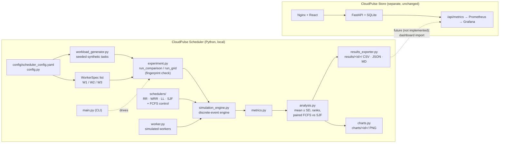
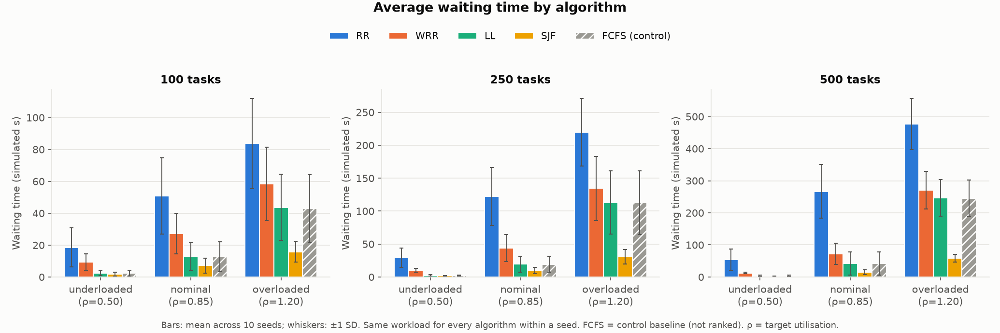
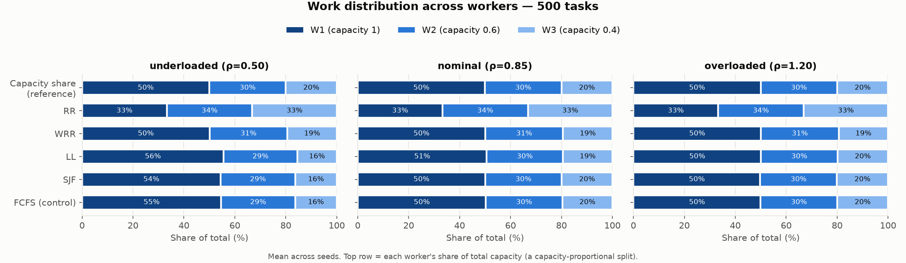
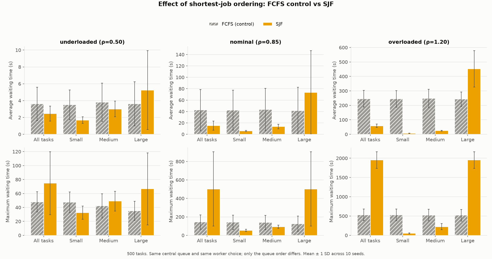

# CloudPulse Scheduler

Workload-scheduling simulator for the university Cloud Computing project
**CloudPulse: Intelligent Cloud Resource Monitoring and Workload Scheduling System**.

It compares four scheduling algorithms — **Round Robin (RR), Weighted Round Robin (WRR),
Least Loaded (LL) and Shortest Job First (SJF)** — on identical synthetic workloads, using a
deterministic discrete-event simulation of three heterogeneous workers. A **First-Come-First-Served
(FCFS) control baseline** is run alongside them to separate cause and effect. FCFS is *not* a
fifth algorithm under study and is never ranked.

> Part of the [CloudPulse monorepo](../README.md).

> **Status:** Stages 1–5 complete (plan, core, validation, experiments, documentation).
> Tested locally on macOS (Apple Silicon M1), Python 3.11.13. The scheduler has **not** been
> containerised or deployed to AWS EC2; that is Stage 6 and has not started.

```bash
uv venv --python 3.11 .venv && uv pip install --python .venv -r requirements.txt
.venv/bin/python -m pytest                                   # 220 tests
.venv/bin/python -m src.main --algorithm all --tasks 100     # one workload, all configurations
```

---

## Contents
1. [Project overview](#1-project-overview)
2. [System architecture](#2-system-architecture)
3. [Scheduling algorithms](#3-scheduling-algorithms)
4. [Experimental methodology](#4-experimental-methodology)
5. [Performance metrics](#5-performance-metrics)
6. [Installation and execution](#6-installation-and-execution)
7. [Results and key findings](#7-results-and-key-findings)
8. [Limitations and future improvements](#8-limitations-and-future-improvements)
9. [Project structure](#9-project-structure)
10. [Documentation index](#10-documentation-index)

---

## 1. Project overview

### Purpose and objectives
1. Implement RR, WRR, LL and SJF behind one common scheduler interface.
2. Run them on **the same workload and the same workers**, so differences come only from the algorithm.
3. Measure waiting time, turnaround, response time, makespan, throughput, simulated worker
   utilisation and load distribution.
4. Repeat each experiment over several random seeds, workload sizes and load levels, and report
   mean ± standard deviation instead of single runs.
5. Export results to CSV/JSON and charts so they can be analysed and, later, shown on the
   CloudPulse monitoring dashboard.

### Problem statement
A cloud service receives a stream of tasks of different sizes and must decide which worker runs
each task and in what order. Workers are not equally fast. A poor decision leaves fast workers idle
while tasks queue behind slow ones; a decision that favours short tasks may make long tasks wait
much longer. The question is: **how do common scheduling policies trade average performance,
worst-case waiting and load balance on heterogeneous workers, and how does this change with load?**

### Why monitoring and scheduling matter
Scheduling decides how fast users get results and how well paid-for capacity is used. Monitoring
is what tells operators whether that is happening: queues growing, workers saturated, latency rising.
This project studies the scheduling side in a controlled simulation; CloudPulse Store and its
Prometheus/Grafana stack provide the monitoring side on real infrastructure.

### Scope
- **In scope:** a simulator with 4 algorithms + 1 control, reproducible workloads, validation tests,
  a 450-run experiment grid, CSV/JSON/Markdown results and PNG charts.
- **Out of scope:** real task execution on real servers, multi-instance orchestration, Kubernetes,
  machine-learning scheduling, authentication, real customer data. All "time" is simulated seconds.

---

## 2. System architecture

CloudPulse has two independent components. They share a project, not code.

| Component | What it is | Where it runs today |
|---|---|---|
| **CloudPulse Store** (`../cloudpulse-store`) | Dummy e-commerce site (React + FastAPI + SQLite, Docker Compose) that produces real web traffic, with Prometheus metrics and an optional Prometheus + Grafana profile | Docker locally; EC2 setup/deploy scripts in `cloudpulse-store/deployment/aws/` |
| **CloudPulse Scheduler** (this folder) | Standalone Python simulator; no web server, no network ports, no database | Locally only (macOS M1) |

The scheduler does **not** call the store, read its metrics or send metrics to Prometheus. Its
"workers" are simulated objects, not containers or EC2 instances.



| Module | Responsibility |
|---|---|
| `src/workload_generator.py` | `Task` (frozen), `WorkloadConfig`, seeded generation, CSV/JSON save/load, SHA-256 fingerprint |
| `src/worker.py` | `WorkerSpec` (frozen) and the runtime `Worker`: FIFO queue, busy time, estimated load |
| `src/schedulers/` | `base.py` interfaces, one file per algorithm, `fcfs_baseline.py` control |
| `src/simulation_engine.py` | Event loop, dispatch, exactly-once checks, idle-while-waiting diagnostic |
| `src/experiment.py` | Runs all configurations on one frozen workload; runs the size × load × seed grid |
| `src/metrics.py` | Per-run metrics, per task class and per worker |
| `src/analysis.py` | Aggregation over seeds, ranking (primaries only), paired SJF − FCFS deltas |
| `src/results_exporter.py`, `src/charts.py` | Output files and charts |
| `src/main.py` | Command-line interface |

---

## 3. Scheduling algorithms

The simulator uses two dispatch models, because the algorithms need different information
(details: [`docs/design.md`](docs/design.md)).

| | Per-worker FIFO queues — **RR, WRR, LL** | Central queue — **SJF, FCFS control** |
|---|---|---|
| Decision time | When a task **arrives** | When a worker becomes **idle** |
| Decision | Which worker gets the task | Which waiting task runs next, on which idle worker |
| Where tasks wait | That worker's own queue (never moved) | One shared queue |

All execution is **non-preemptive**: a started task runs to completion. A worker with capacity `c`
runs a task in `actual_duration / c` simulated seconds. Schedulers can see only the
`estimated_duration`; the engine runs the hidden `actual_duration`.

### Primary algorithms

| | **Round Robin** | **Weighted Round Robin** | **Least Loaded** | **Shortest Job First** |
|---|---|---|---|---|
| File | `round_robin.py` | `weighted_round_robin.py` | `least_loaded.py` | `shortest_job_first.py` |
| How it works | Rotating pointer: W1, W2, W3, W1, …; skips unavailable or full workers | Smooth (Nginx-style) WRR. Weights 5:3:2 give the repeating order W1 W2 W3 W1 W1 W2 W1 W3 W2 W1 | Sends each task to the worker with the lowest **estimated** load = remaining estimated time of the running task + estimated time of queued tasks, both ÷ capacity | Keeps waiting tasks in a min-heap on `(estimated_duration, arrival_time, task_id)`; a free worker takes the shortest. With several idle workers, the fastest one goes first |
| Uses task size? | No | No (static weights) | Yes, estimates | Yes, estimates |
| Tie-breaking | Pointer order | Lowest config index | Load rounded to 1e-9, then lowest config index | Heap key; worker: highest capacity, then lowest index |
| Advantages | Simplest; equal task counts; no information needed | Proportional to capacity when weights match speeds; predictable | Reacts to actual queue build-up; keeps all workers busy | Minimises average waiting when estimates are good |
| Limitations | Ignores speed differences: the slowest worker becomes the bottleneck | Ignores task size and queue state; a worker can be idle while another's queue grows | Depends on estimates; binds a task to a worker early (no later rebalancing) | Depends on estimates; **can starve large tasks** (no ageing) |
| Role in experiments | Size-blind, capacity-blind reference | Capacity-aware but static | Dynamic load-aware push dispatch | Size-aware ordering |

WRR weights are configurable in `config/scheduler_config.yaml` or with `--weights`.

### FCFS — control baseline (not a primary algorithm)
`src/schedulers/fcfs_baseline.py`, role `control`. It uses the same central queue and literally the
same worker-selection code as SJF (`CentralQueueScheduler.select_idle_worker`), but serves tasks
in **arrival order**. A test checks that SJF and FCFS give identical schedules when all estimates
are equal. Why it exists: SJF differs from RR/WRR/LL in two ways at once (shortest-first ordering
*and* a central queue). With FCFS in the experiment:
- **SJF − FCFS** = the effect of shortest-first ordering alone;
- **FCFS − RR/WRR/LL** = the effect of the central queue plus worker choice, without size ordering.

FCFS appears in every table and chart as "FCFS (control)" with grey hatched bars and is excluded
from every ranking.

---

## 4. Experimental methodology

Full detail: [`docs/methodology.md`](docs/methodology.md). All values below are the ones in
`config/scheduler_config.yaml` and the code defaults.

**Discrete-event simulation.** Events (`ARRIVAL`, `COMPLETION`) sit in a heap ordered by
`(time, kind, sequence)`; completions are processed before arrivals at the same time. All events at
one timestamp are applied, then one dispatch step runs. Time jumps from event to event; nothing
depends on wall-clock time. The engine raises an error if any task starts or completes twice or
never finishes.

**Workers (fixed for all runs).**

| Worker | Capacity (speed) | Share of total capacity | WRR weight |
|---|---|---|---|
| W1 | 1.0 | 50 % | 5 |
| W2 | 0.6 | 30 % | 3 |
| W3 | 0.4 | 20 % | 2 |

**Task sizes** (seconds on a capacity-1.0 worker):

| Class | Probability | Actual duration |
|---|---|---|
| small | 60 % | Uniform(1, 5) |
| medium | 30 % | Uniform(5, 20) |
| large | 10 % | Uniform(20, 60) |

Mean task size = 0.6·3 + 0.3·12.5 + 0.1·40 = 9.55 s.

**Estimated vs actual time.** Each task has `estimated_duration = actual × Uniform(0.8, 1.2)`
(±20 %, `estimate_error: 0.20`). LL and SJF decide using the estimate; RR and WRR use no size
information. Tests (runtime spy, source scan and a counterfactual that scrambles actual durations)
confirm that no scheduler reads the actual duration or a future completion time.

**Arrivals and load conditions.** Arrivals are Poisson with
rate = ρ × total capacity ÷ mean task size, where total capacity = 2.0.

| Condition | ρ (target utilisation) | Arrival rate |
|---|---|---|
| Underloaded | 0.50 | ≈ 0.105 tasks/s |
| Nominal | 0.85 | ≈ 0.178 tasks/s |
| Overloaded | 1.20 | ≈ 0.251 tasks/s |

"Overloaded" means arrivals outpace capacity, so a backlog grows during the arrival period. The
workload is finite, so the system drains afterwards and every task completes.

**Grid.** 3 sizes (100, 250, 500 tasks) × 3 load conditions × 10 seeds (42–51) × 5 configurations
= **450 runs**.

**Fair comparison.**
1. Each (size, load, seed) cell generates **one** workload, frozen into a tuple and given to all five
   configurations. `Task` and `WorkerSpec` are immutable; each run builds fresh workers.
2. SHA-256 fingerprints of the workload and worker configuration are checked inside every run; a
   mismatch raises an error. All 90 workload fingerprints are stored in `experiment_summary.json`.
3. Same engine, clock, tie-breaking rules and metric code for every configuration.

**Why multiple seeds.** One random workload is one sample. The seed-to-seed spread is large
(e.g. LL, 500 tasks, nominal: average wait 42.41 ± 35.97 s), so a single run could reverse a
conclusion. Ten seeds give a mean, a spread and a count of how often each algorithm won.

**Mean and standard deviation.** For each (size, load, configuration), every metric is averaged
over the 10 seeds (`statistics.fmean`), with the **sample** standard deviation
(`statistics.stdev`, divisor n − 1). "Wins" = number of seeds on which an algorithm had the best
value among the four primaries (ties share the win). Ranks use competition ranking on the means.
FCFS vs SJF uses **paired** per-seed differences on the identical workload.

---

## 5. Performance metrics

All times are simulated seconds. Response time equals waiting time because execution is
non-preemptive (a task's first run is its only run).

| Metric | Definition | Better | What it tells you |
|---|---|---|---|
| Average waiting time | mean of (start − arrival) | lower | Typical delay before work begins |
| Average turnaround time | mean of (completion − arrival) | lower | Total time a user waits for a result (waiting + execution) |
| Average response time | mean of (first execution − arrival) | lower | Same as waiting time here; kept for completeness |
| 95th-percentile waiting time | nearest-rank p95 of waiting time | lower | The delay that 95 % of tasks beat — the "bad but not worst" case |
| Maximum waiting time | longest wait of any task | lower | Worst case; exposes starvation |
| Makespan | time of the last completion (clock starts at 0) | lower | How long the whole workload takes |
| Throughput | tasks ÷ makespan | higher | Completed tasks per simulated second |
| Worker utilisation | busy time ÷ makespan, per worker and mean over available workers | context | How occupied each *simulated* worker was — see note below |
| Utilisation imbalance (CV) | population SD ÷ mean of per-worker utilisation | lower | How evenly busy the workers were |
| Load distribution | each worker's share of tasks, of work and of busy time | compare with capacity share | Whether work went to workers in proportion to their speed |
| Idle-while-waiting % | worker-seconds a free worker sat idle while some task was waiting ÷ (makespan × workers) | lower | Wasted capacity caused by binding tasks to the wrong queue |
| Per-class waiting | the waiting metrics for small / medium / large tasks separately | lower | Who pays for an average improvement |

**Utilisation is not EC2 CPU.** Simulated utilisation describes the model's clock, not the machine.
The whole 450-run grid takes about 1.6 s of real time on one M1 core. Higher mean utilisation is
not automatically better: the same work keeps a slow worker busy for longer, so a policy that
overloads slow workers can show high utilisation *and* the worst waiting times (see §7).

---

## 6. Installation and execution

### Prerequisites
- macOS or Linux with **Python 3.11** (the version used for all reported results).
- [`uv`](https://docs.astral.sh/uv/) (recommended; it can download Python 3.11 for you) or a local
  Python 3.11 with `venv`.
- No Docker, database or network service is needed.

### Set up the virtual environment
Run from the `cloudpulse-scheduler/` folder.

```bash
# Option A — uv (used for this project)
uv venv --python 3.11 .venv
uv pip install --python .venv -r requirements.txt

# Option B — standard library venv (requires python3.11 on PATH)
python3.11 -m venv .venv
.venv/bin/pip install -r requirements.txt
```

Dependencies (`requirements.txt`): PyYAML 6.0.3, matplotlib 3.11.2, pytest 9.2.0.
The commands below call `.venv/bin/python` directly; after `source .venv/bin/activate` you can
write `python` instead.

### Run the tests
```bash
.venv/bin/python -m pytest          # expected: 220 passed
```

### Run one algorithm on one workload
```bash
.venv/bin/python -m src.main --algorithm round_robin --tasks 100
```
`--algorithm` accepts `round_robin`, `weighted_round_robin`, `least_loaded`,
`shortest_job_first`, `fcfs_baseline` (control) or `all`.

### Run the four primary algorithms (without / with the FCFS control)
```bash
.venv/bin/python -m src.main --algorithm all --no-control --tasks 100   # RR, WRR, LL, SJF
.venv/bin/python -m src.main --algorithm all --tasks 100                # + FCFS (control)
```
Useful options: `--seed 7`, `--load 1.2`, `--workers 4 --capacities 1,1,0.5,0.5 --weights 2,2,1,1`,
`--size-mix small=0.6,medium=0.3,large=0.1`, `--estimate-error 0.2`, `--no-charts`.
Run `.venv/bin/python -m src.main --help` for the full list.

### Save and reuse a workload
```bash
.venv/bin/python -m src.main --generate-workload data/workloads/w100_s42.csv --tasks 100 --seed 42
.venv/bin/python -m src.main --algorithm all --workload data/workloads/w100_s42.csv
```

### Run the complete experiment grid
```bash
.venv/bin/python -m src.main --grid --experiment-id my-grid
```
This runs the 450 runs defined under `experiment.grid` in the config. `--seeds 42,43` and
`--sizes 100` shrink the grid for a quick check. Re-running reproduces every metric value exactly;
only the timestamp changes. To regenerate the reported results in place use
`--experiment-id stage4-grid` (this overwrites `results/stage4-grid/` and `charts/stage4-grid/`).

### Where results and charts go
Every run writes to `results/<experiment-id>/` and `charts/<experiment-id>/`. Without
`--experiment-id` the folder name is a UTC timestamp with one-second resolution, such as
`single-20261106T101500Z`; two runs started in the same second write to the same folder, so pass
`--experiment-id` when scripting several runs.

| File | Contents |
|---|---|
| `results.csv` / `results.json` | One row per run (flat / nested) |
| `algorithm_comparison.csv` | Mean, SD, rank, wins per (size, load, configuration) |
| `fcfs_vs_sjf.csv` | Paired SJF − FCFS deltas (only when both SJF and FCFS run) |
| `per_worker.csv` | One row per run × worker |
| `experiment_summary.json` | Settings, worker config, fingerprints, metric definitions, best per metric |
| `comparison_tables.md` | Human-readable tables generated from the CSVs |
| `task_records.csv` | Every task's timeline (single-workload runs only) |
| `charts/<id>/*.png` | Up to 10 charts (see §7); the FCFS-vs-SJF chart is produced only when both run, and single-workload charts have no error bars |

Other scripts: `.venv/bin/python -m scripts.validate_stage3` prints the Stage 3 fairness and
integrity evidence.

---

## 7. Results and key findings

Source: `results/stage4-grid/` (450 runs). Full tables: `results/stage4-grid/comparison_tables.md`.
Full discussion: [`docs/stage4_results.md`](docs/stage4_results.md). Values are mean ± sample SD over
10 seeds, simulated seconds. These results hold for this model (three heterogeneous workers,
unbiased ±20 % estimates, Poisson arrivals); they are not a general ranking of the algorithms.

### 500 tasks — average waiting time (mean ± SD) / maximum waiting time (mean)

| | Underloaded ρ = 0.50 | Nominal ρ = 0.85 | Overloaded ρ = 1.20 |
|---|---|---|---|
| RR | 54.25 ± 33.67 / 435.04 | 266.74 ± 83.89 / 1389.33 | 477.06 ± 79.86 / 2110.92 |
| WRR | 12.62 ± 2.78 / 166.69 | 72.03 ± 33.15 / 359.71 | 270.93 ± 58.35 / 731.08 |
| LL | 3.69 ± 1.88 / 53.11 | 42.41 ± 35.97 / 150.99 | 246.43 ± 57.01 / 543.97 |
| SJF | 2.46 ± 0.88 / 74.71 | 15.15 ± 7.89 / 502.67 | 58.44 ± 11.67 / 1952.46 |
| FCFS (control) | 3.61 ± 1.98 / 47.92 | 42.55 ± 36.16 / 143.60 | 245.74 ± 56.96 / 531.07 |



### Comparison of the four primary algorithms
- **No algorithm is best on every metric.** SJF ranks 1st on average waiting, turnaround, response
  and p95 waiting time in all 9 (size × load) cells. **LL ranks 1st on maximum waiting time in all 9
  cells**, where SJF is 2nd or 3rd.
- **Makespan/throughput:** LL is best in most cells, but the gaps between LL, SJF and WRR are much
  smaller than the seed SD (500 nominal: LL 2876 ± 120, SJF 2901 ± 118, WRR 2979 ± 127 s), so these
  ranks are not meaningful. RR is clearly worst at nominal and overloaded load (500 nominal: 4154 ± 479 s).
- **RR is worst on every time metric in every cell.**
- **WRR** ranks 3rd on average waiting time in every cell: better than RR, worse than LL and SJF.
- **LL** is 2nd on average waiting time and keeps idle-while-waiting at 0.2–0.3 %.

### Worker capacity imbalance (500 tasks, nominal load)

| | W1 / W2 / W3 task share | W1 / W2 / W3 work share | W1 / W2 / W3 utilisation |
|---|---|---|---|
| Capacity share | 50 / 30 / 20 % | 50 / 30 / 20 % | — |
| RR | 33.4 / 33.4 / 33.2 % | 33.3 / 33.5 / 33.2 % | 39.8 / 67.1 / **97.7** % |
| WRR | 50.0 / 30.0 / 20.0 % | 50.1 / 30.6 / 19.4 % | 82.5 / 83.7 / 79.6 % |
| LL | 51.7 / 29.6 / 18.6 % | 50.6 / 29.9 / 19.4 % | 86.3 / 85.1 / 82.9 % |

RR gives each worker a third of the work, but W3 has only 20 % of the capacity, so W3 saturates and
its queue grows while W1 is mostly idle. WRR matches the capacity split but cannot react when random
task sizes make one queue grow: a free worker sits idle while tasks wait elsewhere 7.7–18.1 % of the
time (RR 22.0–29.9 %, LL 0.2–0.3 %, SJF/FCFS 0 by design).



### FCFS (control) vs SJF — the effect of shortest-first ordering
Same central queue, same worker choice, same workload; paired per seed. Negative = SJF lower.

| SJF vs FCFS, % change of the mean | Underloaded | Nominal | Overloaded |
|---|---|---|---|
| Average waiting time (100 / 250 / 500 tasks) | −21.3 / −21.5 / −31.8 % | −44.6 / −49.0 / −64.4 % | −63.1 / −72.7 / −76.2 % |
| Large-task average waiting time | +15.2 / +12.9 / +45.1 % | +68.9 / +62.4 / +76.9 % | +79.5 / +83.4 / +86.0 % |
| Maximum waiting time | +23.8 / +29.0 / +55.9 % | +66.8 / +93.9 / +250.1 % | +106.0 / +205.5 / +267.6 % |
| Makespan | 0.0 / −0.0 / −0.0 % | +3.1 / +1.4 / +1.0 % | +2.9 / +2.0 / +1.4 % |

At 250 and 500 tasks SJF had the lower average wait on 10/10 seeds in every load condition (100 tasks,
underloaded: 8/10).



### Waiting-time trade-offs and SJF starvation
- Shortest-first ordering cuts the **average** wait sharply, and more as load rises, by moving small
  and medium tasks forward.
- **Large tasks pay for it.** At nominal and overloaded load their average wait rises 62–86 % and the
  maximum wait rises 1.7–3.7× (500 overloaded: 531 → 1952 s). With no ageing, a large task can be
  overtaken again and again while short tasks keep arriving — this is starvation.
- Makespan barely changes (−0.0 % to +3.1 %): ordering changes *who* waits, not how much work there is.

### Central queue vs worker choice
FCFS and LL give almost the same average waiting time: the difference of the means is under 1 s in
every cell (500 nominal: 42.55 vs 42.41 s). So LL loses little by binding tasks early, and almost
all of SJF's advantage over LL comes from **ordering**, not from the central queue. For RR and WRR,
early binding is costly: FCFS beats WRR on average wait in every cell (500 nominal: 42.55 vs 72.03 s).

### Why higher utilisation does not mean better performance
When underloaded, RR has the **highest** mean utilisation (500 tasks: 57.0 % vs LL 49.4 %) together
with the **worst** waiting times. Its mean is high only because it overloads the slow W3 (82.2 % busy)
while W1 sits at 33.1 %. Read utilisation together with waiting time and the per-worker chart. And
again: these are simulated workers, not EC2 CPU.

### Charts (`charts/stage4-grid/`)
`01_avg_waiting_time`, `02_avg_turnaround_time`, `03_throughput`, `04_worker_utilisation`,
`05_makespan`, `06_load_distribution`, `07_per_worker_utilisation`, `08_fcfs_vs_sjf`,
`09_max_waiting_time`, `10_idle_while_waiting` (all `.png`). Error bars show ±1 SD across seeds.

---

## 8. Limitations and future improvements

### Limitations
- **Simulation, not real execution.** Times are simulated seconds and utilisation is simulated busy
  time. They are not EC2 CPU, memory or latency measurements, and say nothing about the cost of
  running the simulator itself.
- **Estimates.** LL and SJF depend on estimated processing times. The noise model is unbiased
  ±20 % uniform; real estimates are often biased or worse, and results could change.
- **Starvation.** SJF has no ageing, so large tasks can wait far longer than under FCFS or LL.
- **Workload and seed dependence.** Results depend on the task-size mix, Poisson arrivals, the
  three-worker configuration and the 10 seeds used. Ten seeds give useful but not tight
  confidence; no formal significance tests are run (paired differences and win counts are used).
- **Simplified worker model.** Constant worker speed, static availability, one task at a time, no
  dispatch/network/context-switch overhead, no failures, no work stealing between queues.
- **Hybrid dispatch design.** RR/WRR/LL bind on arrival and SJF/FCFS bind when a worker is idle;
  the FCFS control measures this effect but does not remove it.
- **Experimental component.** The scheduler is a research simulator, not a production cloud
  orchestration platform. It has only been run locally; it is not deployed to EC2.

Full list: [`docs/design.md` §Limitations](docs/design.md#limitations-of-the-hybrid-design-for-academic-comparison).

### Possible future improvements (not implemented)
- SJF with ageing, to bound large-task waiting.
- Work stealing between per-worker queues.
- Biased or heavier-tailed estimate errors and task sizes, as a sensitivity study.
- More seeds and confidence intervals.
- Exporting summary metrics in a form the existing CloudPulse Prometheus/Grafana stack can display
  (internal only, no new public ports).
- Containerising the scheduler for the existing EC2 instance (planned as Stage 6).

---

## 9. Project structure

```
cloudpulse-scheduler/
├── config/scheduler_config.yaml   workers, workload parameters, experiment grid
├── src/
│   ├── main.py                    CLI
│   ├── config.py                  YAML loading and validation
│   ├── workload_generator.py      tasks, generation, save/load, fingerprints
│   ├── worker.py                  WorkerSpec and simulated Worker
│   ├── simulation_engine.py       discrete-event engine
│   ├── schedulers/                base.py, round_robin.py, weighted_round_robin.py,
│   │                              least_loaded.py, shortest_job_first.py, fcfs_baseline.py
│   ├── experiment.py              run_comparison, run_grid
│   ├── metrics.py                 per-run metrics
│   ├── analysis.py                aggregation, ranks, FCFS vs SJF
│   ├── results_exporter.py        CSV / JSON / Markdown output
│   └── charts.py                  matplotlib charts
├── tests/                         220 pytest tests (+ conftest.py, invariants.py helpers)
├── scripts/validate_stage3.py     fairness / integrity evidence printer
├── docs/                          design, methodology, validation report, results
├── data/workloads/                saved workloads (empty by default)
├── results/stage4-grid/           reported experiment results
├── charts/stage4-grid/            reported charts
├── requirements.txt, pytest.ini, .gitignore
└── README.md
```

---

## 10. Documentation index

| Document | Purpose |
|---|---|
| `README.md` (this file) | Overview, how to run, headline results |
| [`docs/design.md`](docs/design.md) | Implementation design: dispatch models, event rules, tie-breaking, assumptions, full limitations list |
| [`docs/methodology.md`](docs/methodology.md) | Research questions, why the FCFS control, experimental design, fairness, metric definitions |
| [`docs/stage3_validation_report.md`](docs/stage3_validation_report.md) | Fairness and reliability validation (Stage 3 record) |
| [`docs/stage4_results.md`](docs/stage4_results.md) | Full experiment findings with all cells |
| `docs/stage3_validation_output.txt`, `docs/stage4_grid_terminal_output.txt` | Raw terminal output of the validation script and the grid run |
| `results/stage4-grid/comparison_tables.md` | Every number, generated from the CSVs |
