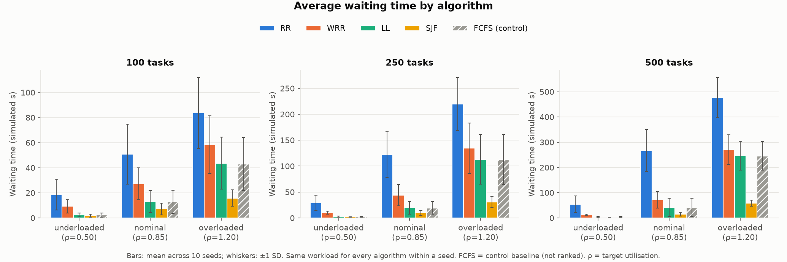

# `charts/stage4-grid/` — Stage 4 charts

Ten PNG charts generated from [`results/stage4-grid/`](../../results/stage4-grid/README.md).
Bars show the mean over 10 seeds with ±1 SD error bars. Each algorithm keeps one colour in every
chart; FCFS appears as "FCFS (control)" with grey hatched bars and is never ranked.

| File | Shows |
|---|---|
| `01_avg_waiting_time.png` | Average waiting time |
| `02_avg_turnaround_time.png` | Average turnaround time |
| `03_throughput.png` | Throughput (tasks per simulated second) |
| `04_worker_utilisation.png` | Mean simulated worker utilisation |
| `05_makespan.png` | Makespan |
| `06_load_distribution.png` | Share of tasks/work per worker vs capacity share |
| `07_per_worker_utilisation.png` | Utilisation of W1, W2, W3 separately |
| `08_fcfs_vs_sjf.png` | Paired SJF − FCFS comparison (effect of shortest-first ordering) |
| `09_max_waiting_time.png` | Maximum waiting time (exposes SJF starvation) |
| `10_idle_while_waiting.png` | Idle-while-waiting % (capacity lost to early binding) |

Utilisation here is simulated busy time, not EC2 CPU. Interpretation:
[`docs/stage4_results.md`](../../docs/stage4_results.md).

