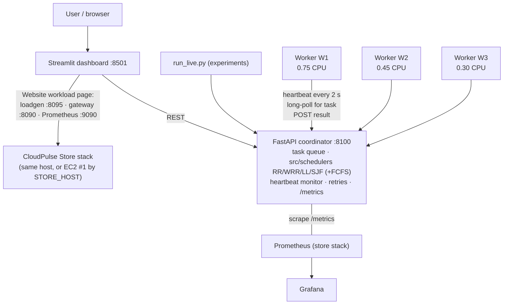

# CloudPulse live cluster (real execution)

The offline simulator (`src/`) compares the scheduling algorithms in **simulated seconds**.
`live/` runs the **same scheduler classes** against real worker services that execute real
computational tasks, report real CPU/memory measurements and can really crash.

| Part | File | What it does |
|---|---|---|
| Coordinator | `coordinator/app.py`, `coordinator/cluster.py` | FastAPI. Task queue, scheduling, dispatch, heartbeat monitoring, failure detection, retries, statistics, Prometheus `/metrics` |
| Worker | `worker/app.py`, `worker/agent.py`, `worker/metrics.py` | FastAPI. Sends heartbeats, pulls tasks, executes them, reports results, measures CPU/memory (psutil + cgroup v2) |
| Tasks | `tasks.py` | Three real, deterministic computations: `prime_count`, `data_aggregation`, `sha256_chain` |
| Dashboard | `dashboard/app.py`, `website_page.py`, `cluster_page.py`, `api.py` | Streamlit, two pages: **Website workload** (default; drives the CloudPulse Store through its `loadgen`, reads the store's scheduling gateway and Prometheus) and **Compute cluster** (this coordinator's API and recorded result files) |
| Experiments | `experiments/run_live.py`, `experiments/live_charts.py` | Algorithm/size grid, worker-failure runs, 1/2/3-worker scaling runs, CSV + charts |
| Calibration | `calibrate.py` | Measures seconds-per-unit of each task type on W1 |

## Architecture



### How the existing algorithms are reused
Each real worker has a *mirror* `src.worker.Worker` object in the coordinator holding its queue
and current task. The coordinator calls the unchanged scheduler methods:

- RR, WRR, LL (per-worker queues): `select_worker(task, workers, now)` when a task arrives;
- SJF and the FCFS control (central queue): `add_task`, then `select_idle_worker` + `pop_next_task`
  when a worker is idle and asking for work.

LL and SJF see only `estimated_duration` (from the calibrated cost model in `tasks.py`); real
execution time is measured by the worker and is never known in advance.

### Real heterogeneity
Worker speeds are not simulated. Each worker container has a Docker CPU quota proportional to its
scheduler capacity: 1.0 / 0.6 / 0.4 → **0.75 / 0.45 / 0.30 CPU** (configurable: `W1_CPUS` …).
The worker reads its quota from `/sys/fs/cgroup/cpu.max` and reports it. Measured on the M1 Mac
(Colima VM, 2 vCPU): one identical `prime_count(300000)` took 0.58 s on W1, 0.90 s on W2 and 1.54 s
on W3 while using ~0.44 s of CPU on each.

### Pull model, heartbeats, failure detection and recovery
- A worker sends a heartbeat every `HEARTBEAT_INTERVAL` (2 s) with its state and measurements.
  The first heartbeat registers it (no static worker list).
- Workers long-poll `POST /workers/{id}/poll`; the coordinator delivers a task only to an
  **active, idle, waiting** worker. Workers need only outbound access to the coordinator.
- Heartbeat age > `UNAVAILABLE_AFTER` (5 s) → **unavailable**: no new tasks.
- Heartbeat age > `FAILED_AFTER` (10 s), or a heartbeat with a new process id (`boot_id`,
  i.e. the worker restarted) → **failed**: its running task is *interrupted* (retried, counts as an
  attempt) and its queued tasks are *reassigned* through the active algorithm.
- A task is retried at most `MAX_ATTEMPTS` (3) times, then marked failed — never silently lost.
- Results from an old attempt (e.g. a worker that was partitioned but kept computing) are
  discarded as stale, so a task is never counted twice.
- When heartbeats return, the worker becomes **active** again and the downtime is recorded.

## Running it (macOS with Colima / Docker Desktop, or Windows with Docker Desktop)

```bash
# from cloudpulse-scheduler/
colima start                                  # if Docker is not running
cp .env.example .env                          # settings live only in .env (ignored by Git)
docker compose up -d --build                  # coordinator + 3 workers + dashboard
docker compose ps                             # wait for "healthy"
open http://localhost:8501                    # Streamlit dashboard
open http://localhost:8100/docs               # coordinator API (Swagger)
```

Windows (PowerShell; translation table in the [root README](../../README.md#windows-powershell)):

```powershell
cd cloudpulse-scheduler                       # Docker Desktop must be running
Copy-Item .env.example .env
docker compose up -d --build
docker compose ps
Start-Process http://localhost:8501
Start-Process http://localhost:8100/docs
```

Submit work from the dashboard sidebar, or:

```bash
curl -s -X POST localhost:8100/scheduler/algorithm -H 'content-type: application/json' \
     -d '{"algorithm":"shortest_job_first"}'
curl -s -X POST localhost:8100/workloads/start -H 'content-type: application/json' \
     -d '{"num_tasks":60,"seed":1,"load":0.85}'
curl -s localhost:8100/scheduler/stats | python3 -m json.tool
```

Windows (PowerShell):

```powershell
Invoke-RestMethod -Method Post http://localhost:8100/scheduler/algorithm -ContentType 'application/json' `
  -Body '{"algorithm":"shortest_job_first"}'
Invoke-RestMethod -Method Post http://localhost:8100/workloads/start -ContentType 'application/json' `
  -Body '{"num_tasks":60,"seed":1,"load":0.85}'
Invoke-RestMethod http://localhost:8100/scheduler/stats | ConvertTo-Json -Depth 6
```

Failure demo (real crash, then restart):

```bash
docker compose kill worker-2       # SIGKILL: no goodbye message
docker compose start worker-2      # rejoins with a new boot id
curl -s 'localhost:8100/events?limit=50' | python3 -m json.tool
```

Windows: the two `docker compose` lines are identical; then
`Invoke-RestMethod 'http://localhost:8100/events?limit=50' | ConvertTo-Json -Depth 6`.

With the store stack also running on the same host, add the store network so the *Website
workload* page works and the store's Prometheus scrapes the coordinator:
`docker compose -f compose.yaml -f compose.monitoring.yaml up -d`.

Stop: `docker compose down`. Memory limits: coordinator 192 MB, each worker 128 MB,
dashboard 320 MB (measured use: workers ≈ 40 MB each).

Without Docker (development; no CPU quotas, so all workers run at the same speed):

```bash
uv venv --python 3.11 .venv && uv pip install --python .venv -r requirements.txt -r requirements-live.txt -r requirements-dashboard.txt
.venv/bin/uvicorn live.coordinator.app:app --port 8100 &
WORKER_ID=W1 CAPACITY=1.0 WEIGHT=5 .venv/bin/uvicorn live.worker.app:app --port 9001 &
WORKER_ID=W2 CAPACITY=0.6 WEIGHT=3 .venv/bin/uvicorn live.worker.app:app --port 9002 &
WORKER_ID=W3 CAPACITY=0.4 WEIGHT=2 .venv/bin/uvicorn live.worker.app:app --port 9003 &
COORDINATOR_URL=http://localhost:8100 .venv/bin/streamlit run live/dashboard/app.py
```

Windows (PowerShell): one window per service, each started from `cloudpulse-scheduler`
(variables set with `$env:` stay in that window only):

```powershell
uv venv --python 3.11 .venv; uv pip install --python .venv -r requirements.txt -r requirements-live.txt -r requirements-dashboard.txt
# window 1
.venv\Scripts\python -m uvicorn live.coordinator.app:app --port 8100
# window 2 (repeat in windows 3 and 4 with W2/0.6/3/9002 and W3/0.4/2/9003)
$env:WORKER_ID="W1"; $env:CAPACITY="1.0"; $env:WEIGHT="5"; .venv\Scripts\python -m uvicorn live.worker.app:app --port 9001
# window 5
$env:COORDINATOR_URL="http://localhost:8100"; .venv\Scripts\python -m streamlit run live/dashboard/app.py
```

## Deployment on AWS (two EC2 instances)

In the current plan this whole stack (coordinator, workers, dashboard) runs on its **own** EC2
instance, and the store on another. `compose.two-host.yaml` points the dashboard at the store's
private IP (`STORE_HOST`), and the coordinator listens on 8100 for the store's Prometheus. Both are
switched on from `.env` only (`COMPOSE_FILE`, `STORE_HOST`, `DASHBOARD_BIND`, `COORDINATOR_BIND`);
nothing machine-specific is committed. Guide:
[`../../cloudpulse-store/docs/AWS_TWO_EC2.md`](../../cloudpulse-store/docs/AWS_TWO_EC2.md) ·
script: [`../deployment/README.md`](../deployment/README.md).

## Coordinator API

| Method | Path | Purpose |
|---|---|---|
| GET | `/health` | Liveness, active algorithm, active worker count, server time |
| GET | `/metrics` | Prometheus metrics (`cloudpulse_worker_up`, `cloudpulse_worker_cpu_percent_of_limit`, `cloudpulse_worker_memory_bytes`, `cloudpulse_sched_*_total`, `cloudpulse_task_exec_seconds`, `cloudpulse_task_turnaround_seconds`) |
| POST | `/tasks/submit` | One task `{"task_type","units"}` or a batch `{"tasks":[...]}` |
| GET | `/tasks`, `/tasks/{id}` | Status, worker, attempts, exec/wait/turnaround/overhead, result, history |
| GET | `/tasks/types` | Available task types |
| POST | `/workloads/start` | Seeded workload `{"num_tasks","seed","load"}` replayed with Poisson arrivals |
| GET | `/workers`, `/workers/{id}` | Status, heartbeat age, assigned/completed, latest CPU/memory |
| GET | `/workers/{id}/metrics?since=` | CPU/memory time series |
| POST | `/workers/heartbeat`, `/workers/{id}/poll`, `/tasks/{id}/result` | Used by workers |
| GET | `/scheduler/algorithms` | RR, WRR, LL, SJF (primary) + FCFS (control) |
| POST | `/scheduler/algorithm` | Change algorithm (409 while tasks are active) |
| GET | `/scheduler/stats` | Counts, throughput, averages, lifetime counters, config |
| POST | `/scheduler/reset` | Archive the current run summary and start a new run |
| GET | `/scheduler/runs` | Archived run summaries |
| GET | `/events` | Worker registered/unavailable/failed/recovered, task requeued/failed, ... |

## Experiments

```bash
# from cloudpulse-scheduler/, with the stack running
.venv/bin/python -m live.experiments.run_live grid    --experiment-id live-mac --sizes 30 60 120 --seeds 1 2 3
.venv/bin/python -m live.experiments.run_live failure --experiment-id live-mac --size 60 --seeds 1 2 3
.venv/bin/python -m live.experiments.run_live scaling --experiment-id live-mac --size 60 --seeds 1 2 3
.venv/bin/python -m live.experiments.live_charts live-mac
```

Windows (PowerShell, Docker Desktop running): the same commands with `.venv\Scripts\python`, e.g.
`.venv\Scripts\python -m live.experiments.run_live grid --experiment-id live-win --sizes 30 60 120 --seeds 1 2 3`.
Use a different `--experiment-id` / `--setup` label per machine so results are not mixed.

- **grid** – every algorithm on the identical workload (same seed → same SHA-256 fingerprint) for
  each size and seed. Load ρ = 0.85 of total capacity, task mix 60/30/10 % small/medium/large.
- **failure** – for each algorithm and seed: one normal run and one run where W2 is killed with
  `docker compose kill` 5 s after the start and restarted 15 s later. Records time to
  *unavailable*/*failed* detection, interrupted and reassigned tasks, retries, time until all
  affected tasks finished, and rejoin time.
- **scaling** – the same workload (arrival rate fixed for capacity 2.0) on W1 only, W1+W2, and
  W1+W2+W3.

Outputs: `results/<id>/runs_*.csv`, `per_worker_*.csv`, `tasks_*.csv`, `events_*.jsonl`,
`*_summary.csv`, `metadata.json` and `charts/<id>/*.png`. Every file is marked as **REAL
execution**; simulator results stay in `results/stage4-grid/` (**SIMULATED**).

## Single-machine vs multi-machine

- **Single machine (done):** coordinator and 3 worker containers on one Docker host. These are
  three processes with separate CPU quotas, **not three machines**; coordinator↔worker traffic
  crosses only the Docker bridge network.
- **Multi-machine (prepared, needs a second host):** run a worker on another machine with
  `compose.remote-worker.yaml`; it only needs to reach the coordinator URL. Measured overhead per
  task = coordinator round trip − worker-measured execution time (`avg_net_overhead_ms`).

  ```bash
  # machine B (e.g. the Mac), coordinator on machine A (e.g. the dashboard EC2), via an SSH tunnel:
  ssh -i <key>.pem -N -L 8100:127.0.0.1:8100 ubuntu@<EC2-IP> &
  # simplest on the Mac: run the worker natively (it reaches the tunnel at localhost)
  COORDINATOR_URL=http://localhost:8100 WORKER_ID=W4 CAPACITY=1.0 WEIGHT=5 CPU_LIMIT_CORES=1 \
    .venv/bin/uvicorn live.worker.app:app --port 9004
  # on a Linux host with direct network access to the coordinator, use the container instead:
  #   COORDINATOR_URL=http://<coordinator-private-ip>:8100 WORKER_ID=W4 \
  #     docker compose -f compose.remote-worker.yaml up -d --build
  #   (coordinator must then publish 8100 on that private interface: COORDINATOR_BIND=<private-ip>)
  # on machine A, stop the local W1 so W4 replaces it, then run the grid with a new setup label:
  docker compose stop worker-1
  python -m live.experiments.run_live grid --setup multi-host --workers W4 W2 W3 ...
  ```
  On a **Windows** laptop as machine B (PowerShell, two windows):

  ```powershell
  ssh -i $HOME\.ssh\cloudpulse-key.pem -N -L 8100:127.0.0.1:8100 ubuntu@<EC2-IP>     # window 1, keep open
  $env:COORDINATOR_URL="http://localhost:8100"; $env:WORKER_ID="W4"; $env:CAPACITY="1.0"; $env:WEIGHT="5"; $env:CPU_LIMIT_CORES="1"
  .venv\Scripts\python -m uvicorn live.worker.app:app --port 9004                        # window 2
  ```

  No extra AWS resources are needed for this (the laptop is the second machine). It has not been run
  yet; see the root README for the status.

## Tests

46 tests: `tests/test_live_tasks.py` (12), `tests/test_live_cluster.py` (15), `tests/test_live_services.py` (19)
(coordinator API, task submission/status, algorithm selection, worker execution, heartbeats,
failure detection, retry limit, stale results, recovery, metrics, dashboard client, and in-process
end-to-end runs with real task execution for all five configurations, including a worker outage;
also the dashboard's website clients).

```bash
.venv/bin/python -m pytest
```
